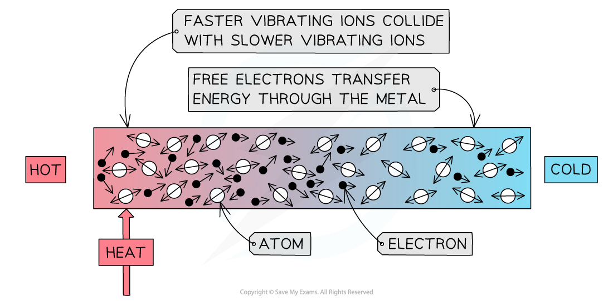

# Thermal Conduction

## Thermal conduction in solids

> **Spec point** — `spcpt_bWZ39rcVktwqypsF`

## Thermal conduction in solids

### Extended Tier Only

- Conduction is the transfer of heat from one region to another through particle vibrations and the movement of free electrons
- Conduction is the main method of thermal energy transfer in **solids**

- Metals are the best thermal **conductors**

  - This is because they have a high number of **free electrons**

***Conduction: the atoms in a solid vibrate and collide, transferring energy***

- Conduction can occur through two mechanisms:

  - Atomic vibrations
  - Free electron collisions
- When a substance is heated, the atoms, or ions, **start to move around (vibrate) more**

  - The atoms at the hotter end of the solid will vibrate more than the atoms at the cooler end
  - As they do so they** bump into each other**, transferring energy from atom to atom
  - These collisions transfer internal energy until **thermal equilibrium** is achieved throughout the substance
  - This occurs in **all solids**, metals and non-metals alike
- Additionally, if a solid contains free electrons, these can travel through the material freely and transfer thermal energy through collisions
