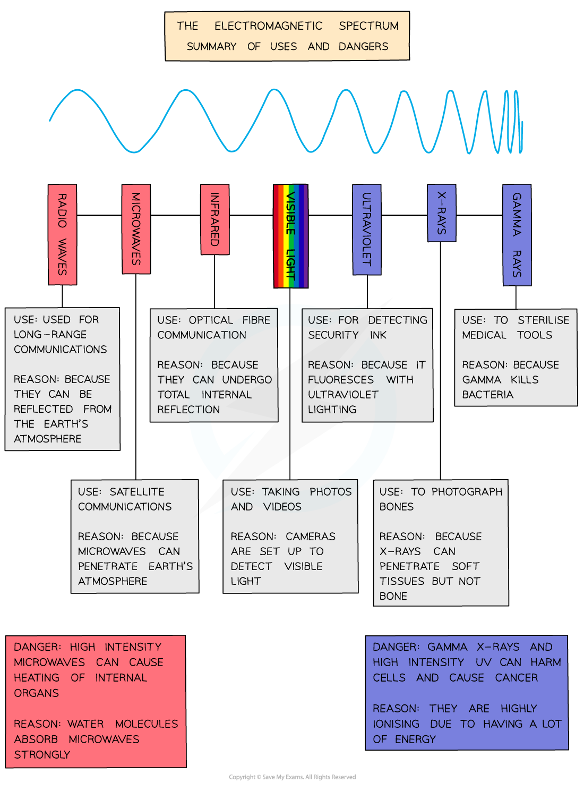

# Uses of Electromagnetic Waves

## Uses of electromagnetic waves

> **Spec point** — `spcpt_cXPYz6qnVjpr6Gvy`

## Uses of electromagnetic waves

#### Typical uses of the different regions of the electromagnetic spectrum

| **Wave** | **Use** |
|---|---|
| Radio | Radio and television transmissions  Radar |
| Microwave | Satellite television  Mobile (cell) phones  Microwave ovens |
| Infrared | Television remote controllers  Thermal imaging |
| Visible light | Vision  Photography |
| Ultraviolet | Detecting fake banknotes |
| X-rays | Medical scanning  Security scanners |
| Gamma rays | Detection of cancer  Treatment of cancer |

#### Typical uses of the different regions of the electromagnetic spectrum

***Uses and dangers of the electromagnetic spectrum***
