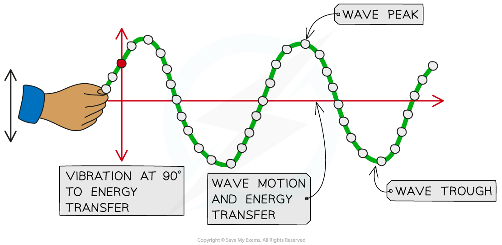

# Transverse & Longitudinal Waves

## Transverse waves

> **Spec point** — `spcpt_RNwqJJ7kcQ8CWPtw`

## Transverse waves

### Extended Tier Only

- Waves can exist as one of two types:

  - **Transverse**
  - **Longitudinal**

### Transverse waves

- Transverse waves are defined as: **Waves where the direction of vibration is at right angles to the direction of propagation**
- For a transverse wave:

  - The energy transfer is **perpendicular to** the wave motion
  - They can move in **solids**, and on the surface of liquids but not in liquids or gases
  - They can move in a** *****vacuum***

#### Transverse wave motion

***Transverse waves can be seen in a rope when it is moved quickly up and down***

- Examples of waves that can be modelled as transverse are:

  - Electromagnetic waves (such as radiowaves, visible light, X-rays etc)
  - Ripples on the surface of water
  - Seismic S-waves (secondary earthquake waves)

## Longitudinal waves

> **Spec point** — `spcpt_g6W3ZnxPpYF5C4g2`

## Longitudinal waves

### Extended Tier Only

- Longitudinal waves are defined as: **Waves where the direction of vibration is parallel to the direction of propagation**
- For a longitudinal wave:

  - The energy transfer is in the **same direction** as the wave motion
  - They can move in solids, liquids and gases
  - They can **not** move in a vacuum (since there are no particles)
- The key features of a longitudinal wave are where the points are:

  - Close together, called **compressions**
  - Spaced apart, called **rarefactions**

#### Longitudinal wave motion

***Longitudinal waves can be seen in a slinky spring when it is moved quickly backwards and forwards***

- Examples of waves that can be modelled as longitudinal waves are:

  - Sound waves
  - Seismic P-waves (primary earthquake waves)

### Difference between transverse and longitudinal waves

#### Comparing transverse and longitudinal waves

| ** Property** | **Transverse waves** | **Longitudinal waves** |
|---|---|---|
| Structure | Peaks and troughs | Compressions and rarefactions |
| Vibration | Right angles to the direction of energy transfer | Parallel to the direction of energy transfer |
| Vacuum | Only electromagnetic waves can travel in a vacuum | Cannot travel in a vacuum |
| Material | Can move in solids and the surfaces of liquids | Can move in solids, liquids and gases |
| Density | A constant density | The density of the wave changes |
| Pressure | Has a constant pressure | Pressure in the wave changes |
| Speed of wave | Depends on the material the wave is travelling in | Depends on the material the wave is travelling in |

> **Exam Hint**
> The key difference between transverse and longitudinal waves is the direction of the vibrations with respect to the direction of the wave itself. For transverse waves, these are perpendicular to each other, whilst for longitudinal waves, these are parallel.
