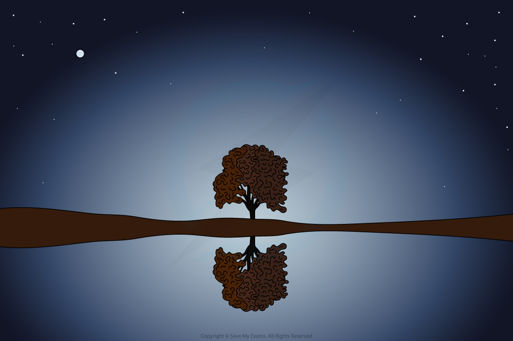
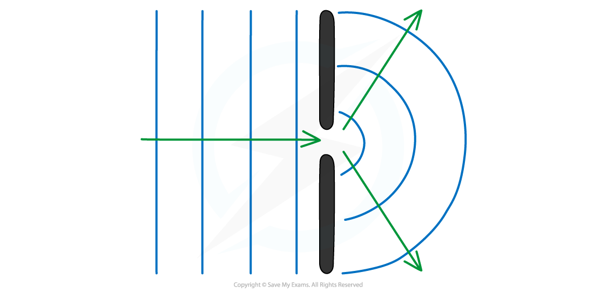

# Wave Behaviour

## Reflection & refraction

> **Spec point** — `spcpt_xbH9HjfrcNnb4g46`

## Reflection & refraction

- All waves, whether transverse or longitudinal, can undergo:

  - **reflection **at a plane surface
  - **refraction **due to a change of speed

- In optics, a transparent material is called a **medium**

  - When referring to more than one medium these are called **media**
- Angles of light are measured from an imaginary line called the **normal**

  - The normal is always **drawn perpendicular** to the **boundary** between two media

### Reflection

- Reflection occurs when: **A wave hits a boundary between two media at a plane surface and does not pass through, but instead stays in the original medium**

#### An example of reflection

***An identical image of the tree is seen in the water due to reflection***

### Refraction

- When waves enter a different medium, their speed can change
- This effect is called **refraction **and it occurs when: **A wave passes a boundary between two different transparent media and undergoes a change in speed**
- When a wave **refracts**, as well as a change in speed, the wave also undergoes:

  - A change in **wavelength** (but frequency stays the same)
  - A change in **direction**

#### An example of refraction

***Waves can change direction when moving between materials with different densities***

- The direction of the incident and refracted rays are also taken from the **normal **line
- If the waves **slow down**, they will bunch together, causing the wavelength to decrease

  - The waves will also start to turn slightly **towards** the normal
- If the waves **speed up** then they will spread out, causing the wavelength to increase

  - The waves will also turn slightly **away from** the normal

> **Exam Hint**
> When drawing waves being reflected take care to:
> 
> - Make sure that the angle of incidence is equal to the angle of reflection
> - Keep the wavelength of the waves the same
> 
> Similarly, when waves are diffracted **the wavelength remains constant.**
> 
> Refraction is the only wave effect in which the wavelength changes.
> 
> **Remember**:
> 
> Refraction is the name given to the change in the speed of a wave when it passes from one medium to another. The change in direction is a consequence of this.

## Diffraction

> **Spec point** — `spcpt_bttQqzzFKSd7rYtY`

## Diffraction

### Diffraction

- When waves pass through a narrow gap, **the waves spread out**
- This effect is called **diffraction**

#### Waves diffracting through a narrow gap

***Diffraction: when a wave passes through a narrow gap, it spreads out***

- The extent of diffraction depends on the **width** of the gap compared with the **wavelength** of the waves

  - Diffraction is the most prominent when the **width** of the slit is approximately **equal** to the **wavelength**
- As the **gap gets bigger**, the **effect **gradually gets **less pronounced** until, in the case that the gap is very much larger than the wavelength, the waves no longer spread out at all

#### Effect of gap size on diffraction

***The size of the gap (compared to the wavelength) affects how much the waves spread out***
