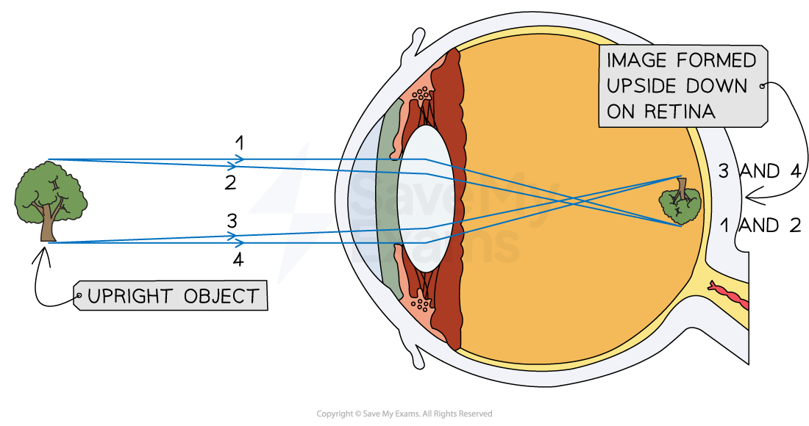
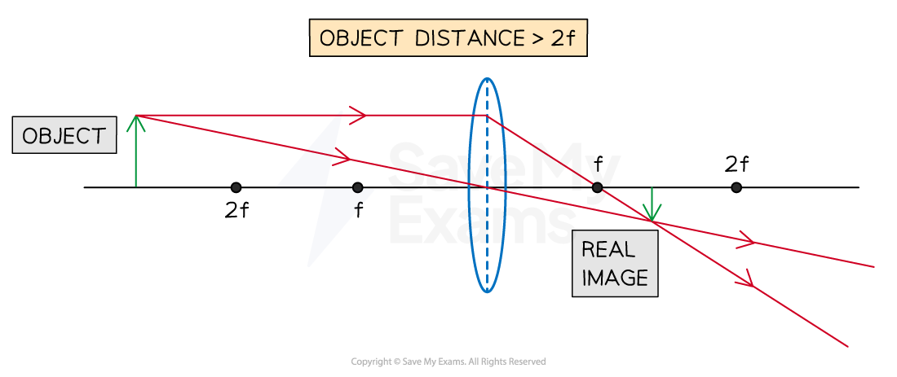
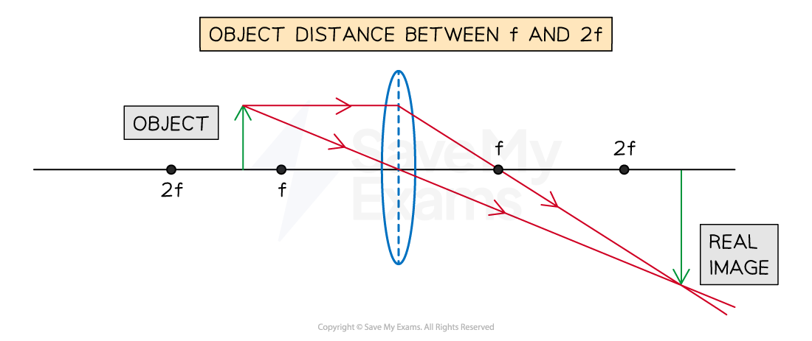

# Images

## Characteristics of images

> **Spec point** — `spcpt_nbt2NwfKzVdgXSP4`

## Characteristics of images

- An image can be described using the following characteristics which compare it to the object:

  - **Enlarged**/same size/**diminished**
  - Upright/**inverted**
- An image viewed through a magnifying glass is:

  - **Enlarged, bigger** than the **object**
  - **Upright**, has the same orientation as the object

#### An image viewed through a magnifying glass

***An image viewed through a magnifying glass is enlarged and upright compared to the object***

- An image viewed through an eye, a camera, or a glasses lens is:

  - **Diminished, smaller** than the **object**
  - **Inverted, upside down** compared to the object

#### An image viewed by the eye

***An image viewed by the eye is diminished and inverted compared to the object***

## Converging lens - real image

> **Spec point** — `spcpt_ZvT97SSvScZ28QVs`

## Converging lens - real image

### Constructing converging ray diagrams

- The three main rules for constructing ray diagrams are as follows:

**1. Rays passing through the principal axis will pass through the optical centre of the lens undeviated**

** **

**2. Rays that are parallel to the principal axis will be refracted and pass through the focal point *****f***

**3. Rays passing through the focal point *****f***** will emerge parallel to the principal axis**

### Drawing converging ray diagrams of real images

- For an object placed at a distance **greater than **2 focal lengths...

#### A converging lens ray diagram for an object placed further than 2f

- The image that forms will have the following properties:

| **The image forms...** | between *f* and 2*f* |
|---|---|
| **The nature of the image is...** | real |
| **The orientation of the image is...** | inverted |
| **The size of the image is...** | diminished |

- For an object placed at a distance **equal to** 2 focal lengths...

#### A converging lens ray diagram for an object placed at 2f

- The image that forms will have the following properties:

| **The image forms...** | at 2*f* |
|---|---|
| **The nature of the image is...** | real |
| **The orientation of the image is...** | inverted |
| **The size of the image is...** | the same |

- For an object placed at a distance **between***** ***1 and 2 focal lengths

#### A converging lens ray diagram for an object placed between f and 2f

- The image that forms will have the following properties:

| **The image forms...** | beyond 2*f* |
|---|---|
| **The nature of the image is...** | real |
| **The orientation of the image is...** | inverted |
| **The size of the image is...** | magnified |

> **Worked Example**
> Draw a ray diagram to show how a converging lens can be used to form a diminished image of a real object.
> 
> Label the object, image and principal foci of the lens on your diagram.
> 
> **Answer:**
> 
> **Step 1: Start by drawing and labelling a principal axis and the lens as a line or a very thin ellipse**
> 
> 
> 
> **Step 2: Mark and label the focal points on each side of the lens**
> 
> 
> 
> **Step 3: Draw and label the object at a distance greater than the focal length on the left side of the lens**
> 
> 
> 
> - Tip: For a diminished image the object should be placed a distance of at least 2F away from the lens
> 
> **Step 4: Draw a ray through the optical centre of the lens **
> 
> 
> 
> **Step 5: Draw a second ray from the object to the lens which is parallel to the principal axis**
> 
> 
> 
> **Step 6: Draw the continuation of the ray passing through the focal point on the right side of the lens**
> 
> 
> 
> **Step 7: Draw and label the image at the point where the rays meet**
> 
> 
> 
> **Step 8: Check your final image and make sure everything is included to gain the marks**
> 
> 
> 
> - For a three-mark question, examiners will be looking for:
> 
>   - One ray drawn through the optical centre of the lens
>   - A second ray drawn which produces a diminished (smaller) image (which must pass through a labelled focal point)
>   - Both the object and the image must be drawn and labelled correctly
