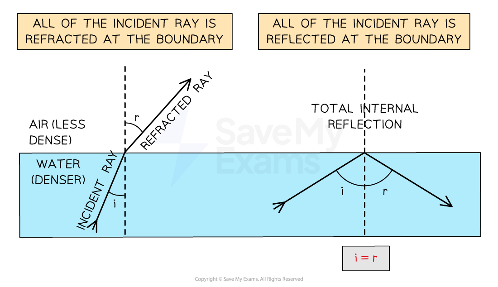
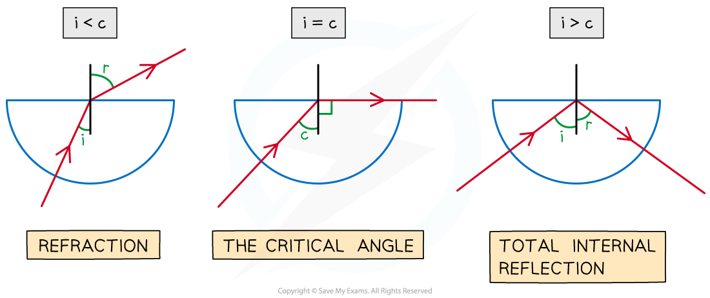
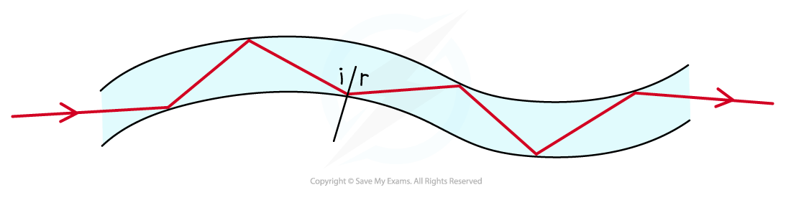
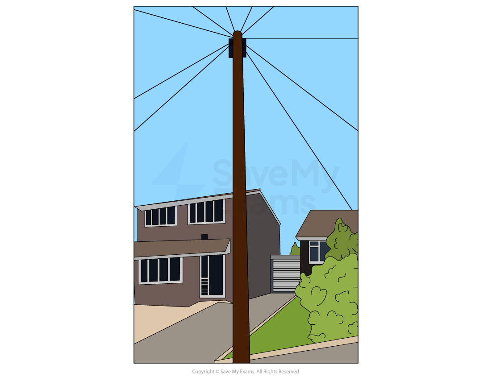

# Total Internal Reflection

## Total internal reflection

> **Spec point** — `spcpt_K5f9t8Q6shkNBkhY`

## Total internal reflection

### Extended tier only

- Sometimes, when light is moving from a denser medium towards a less dense one, instead of being refracted, all of the light is **reflected**

  - This phenomenon is called **total internal reflection**

- **Total internal reflection** (TIR) occurs at the boundary between two media when: **All the incident ray in medium 1 is reflected back into medium 1**

#### Comparing refraction and total internal reflection

***Refraction happens when the angle of incidence is smaller and total internal reflection happens when the angle of incidence equals the angle of reflection***

> **Exam Hint**
> If asked to name the phenomena make sure you give the whole name – **total internal reflection**
> 
> **Remember:** total internal reflection occurs when light travels from a denser material to less dense material and **ALL** of the light is reflected.

## Critical angle

> **Spec point** — `spcpt_4hZHxMkYcWZgVzDc`

## Critical angle

### Extended tier only

- The critical angle is defined as:

**The angle of incidence at which the angle of refraction is 90°and above which all light is totally internally reflected**

- At the boundary between two media, as the angle of incidence is increased, the angle of refraction also increases until it gets closer to 90°
- When the angle of refraction is exactly 90° the light is refracted along the boundary

  - At this point, the angle of incidence is known as the **critical angle** *c*

#### Obtaining total internal reflection examples

***As the angle of incidence increases, it will eventually surpass the critical angle and lead to total internal reflection of the light***

- When the angle of incidence is larger than the critical angle, the refracted ray is now ***reflected***

  - This is *total internal reflection*

> **Worked Example**
> A glass cube is held in contact with a liquid and a light ray is directed at a vertical face of the cube. The angle of incidence at the vertical face is 39° and the angle of refraction is 25° as shown in the diagram. The light ray is totally internally reflected for the first time at **X**.
> 
> 
> 
> Complete the diagram to show the path of the ray beyond **X** to the air and calculate the critical angle for the glass-liquid boundary.
> 
> **Answer:**
> 
> 
> 
> **Step 1: Draw the reflected angle at the glass-liquid boundary**
> 
> - When a light ray is reflected, the angle of incidence = angle of reflection
> - Therefore, the angle of incidence (or reflection) is 90° – 25° = 65°
> 
> **Step 2: Draw the refracted angle at the glass-air boundary**
> 
> - At the glass-air boundary, the light ray refracts **away** from the normal
> - Due to the reflection, the light rays are symmetrical to the other side
> 
> **Step 3: Calculate the critical angle**
> 
> - The question states the ray is “totally internally reflected for the first time” meaning that this is the lowest angle at which TIR occurs
> - Therefore, 65° is the critical angle

> **Exam Hint**
> If you are asked to explain what is meant by the critical angle in an exam, you can be sure to gain full marks by drawing and labelling the same diagram above (showing the three semi-circular blocks)

## Optical fibres

> **Spec point** — `spcpt_mKsfB3GyxxssQFs7`

## Optical fibres

### Extended tier only

- Total internal reflection is used to reflect light along **optical fibres**, meaning they can be used for

  - communications
  - endoscopes
  - decorative lamps
- Light travelling down an optical fibre is **totally internally reflected** each time it hits the edge of the fibre

#### Total internal reflection example: optical fibre

***Optical fibres utilise total internal reflection for communications***

- **Endoscopes** are used to look within the human body

#### Total internal reflection example: endoscope

***Endoscopes**** ****utilise total internal reflection to see inside a patient's body***

- **Optical fibres** can be used in communications to transmit:

  - Home (landline) telephone signals
  - Internet signals
  - Cable television signals

#### Total internal reflection example: telegraph poles

***Fibre optic cables can be found in the phone cables attached between the telephone poles and the street***
