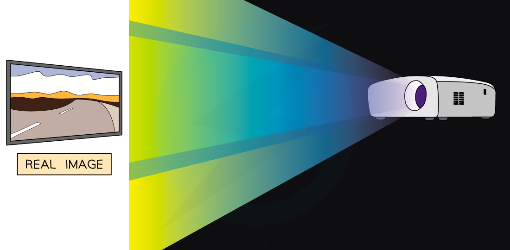
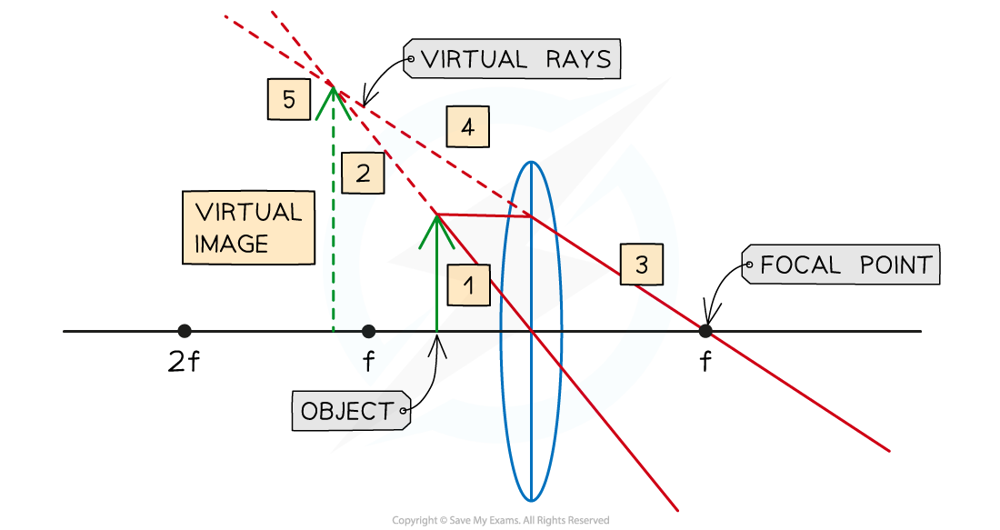

# Virtual Images

##  Virtual images

> **Spec point** — `spcpt_VsQbhHf7HyymzjzJ`

## Converging lens - virtual image

### Extended tier only

- Images produced by lenses can be one of two types:

  - A real image
  - A virtual image
- Images can be described **compared to their object** as:

  - **Enlarged**/same size/**diminished**
  - **Upright/inverted**
  - **Real/virtual**

### Real images

- A real image is defined as: **An image that is formed when the light rays from an object converge and meet each other and can be projected onto a screen**
- A real image is one produced by the **convergence** of light towards a focus
- Real images are always **inverted**
- Real images can be projected onto pieces of paper or screens

  - An example of a real image is the image formed on a cinema screen

#### A real image

***A real image can be projected onto a screen***

### Virtual images

- A virtual image is defined as: **An image that is formed when the light rays from an object do not meet but appear to meet behind the lens and cannot be projected onto a screen**
- A virtual image is formed by the **divergence** of light away from a point
- Virtual images are always **upright**
- Virtual images **cannot** be projected onto a piece of paper or a screen

  - An example of a virtual image is a person's reflection in a mirror

#### A virtual image

***A reflection in a mirror is an example of a virtual image***

### Constructing converging ray diagrams of virtual images

- A single lens placed at a distance **less than** the focal length of an object can be used as a **magnifying glass**

#### A converging lens ray diagram for an object placed less than f

***Ray diagram showing light converging through a magnifying glass to form a magnified virtual image***

- The image that forms will have the following properties:

| **The image forms...** | at 2*f *(on the same side as the object) |
|---|---|
| **The nature of the image is...** | virtual |
| **The orientation of the image is...** | upright |
| **The size of the image is...** | magnified |

- A converging lens will produce a **real** image of an object which is placed at a distance **greater** than the *focal length* from the lens
- If the object is placed **closer** to the lens than the focal length *f* then a **virtual** image will be formed and the converging lens ray diagram will be drawn in the following way:

***A virtual image is formed when the object is placed closer than the focal length***

1. Start by drawing a ray going from the top of the object through the **centre** of the lens. This ray will continue to travel in a straight line
2. Draw a dashed line continuing this ray upwards
3. Next draw a ray going from the top of the object, travelling parallel to the axis to the lens. When this ray emerges from the lens it will travel directly through the **principal focus ***f*
4. Also, draw a dashed line continuing this ray upwards
5. The image is the line drawn from the axis to the point where the two dashed lines **meet**

- In this case, the image is:

  - **Virtual**: the light rays appear to meet when produced backwards
  - **Magnified**: the image is larger than the object
  - **Upright**: the image is formed on the same side of the principal axis
