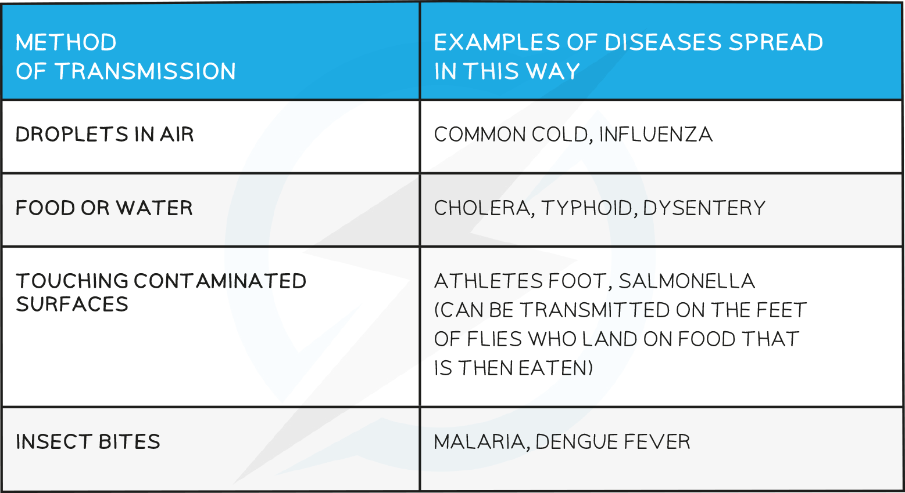
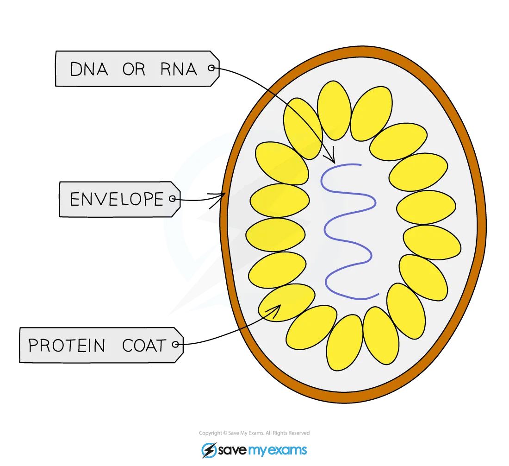

# Pathogens & Barriers

## Pathogens

> **Spec point** — `spcpt_2TZqCySbPkHZqKxv` · Describe a pathogen as a disease-causing organism
Describe a transmissible disease as a disease in which the pathogen can be passed from one host to another
State that a pathogen is transmitted:
(a) by direct contact, including through blood and other body fluids
(b) indirectly, including from contaminated surfaces, food, animals and air

## Pathogens

- A pathogen is a **disease-causing organism**
- Pathogens are passed on from one host to another and therefore the diseases they cause are known as **transmissible diseases**
- Pathogens can be passed on from host to host in different ways, including:

  - **Direct contact** - the pathogen is passed directly from one host to another by transfer of body fluids such as blood or semen (eg HIV, gonorrhoea, hepatitis B & C)
  - **Indirect contact** - the pathogen leaves the host and is carried  by an intermediate medium or vector, such as contaminated surfaces, air (via droplets or aerosols), food, water, or organisms like insects (e.g., mosquitoes carrying malaria or dengue)

**Methods of Transmission Table**

## Virus Structure: Extended

> **Spec point** — `spcpt_jCHq8gmvXkGTP5Kv` · State the features of viruses, limited to a
protein coat and genetic material

## Virus Structure: Extended

- Virus structure is simply

  - **Genetic material** (RNA or DNA)
  - A **protein coat**
  - Some viruses contain an outer envelope as shown in the image below
- As a result, they can only replicate inside living cells

#### Structure of a virus diagram

*Structure of a typical virus*

- The structures of viruses can be varied, but all contain the same basic elements of a protein coat and genetic material

## The Body Defences

> **Spec point** — `spcpt_mqDhn3GRtg7CPxHR` · Describe the body defences, limited to: skin, hairs in the nose, mucus, stomach acid and white blood cells

## The Body Defences

There are **3** main ways in which the body defends itself against disease:

1. **Mechanical barriers** – structures that make it difficult for pathogens to get past them and into the body

  1. **Skin** - covers almost all parts of your body to prevent infection from pathogens. If it is cut or grazed, it immediately begins to heal itself, often by forming a scab
  2. **Hairs in the nose** - these make it difficult for pathogens to get past them further up the nose so they are not inhaled into the lungs
2. **Chemical barriers** – substances produced by the body cells that trap / kill pathogens before they can get further into the body and cause disease

  1. **Mucus** - made in various places in the body, pathogens get trapped in the mucus and can then be removed from the body (by coughing, blowing the nose, swallowing etc)
  2. **Stomach acid** - contains hydrochloric acid which is strong enough to kill any pathogens that have been caught in mucus in the airways and then swallowed or have been consumed in food or water
3. **Cells** - different types of white blood cell work to prevent pathogens reaching areas of the body they can replicate in

  1. By **phagocytosis** - engulfing and digesting pathogenic cells
  2. By producing **antibodies** - which clump pathogenic cells together so they can’t move as easily (known as **agglutination**) and releasing chemicals that signal to other cells that they must be destroyed
