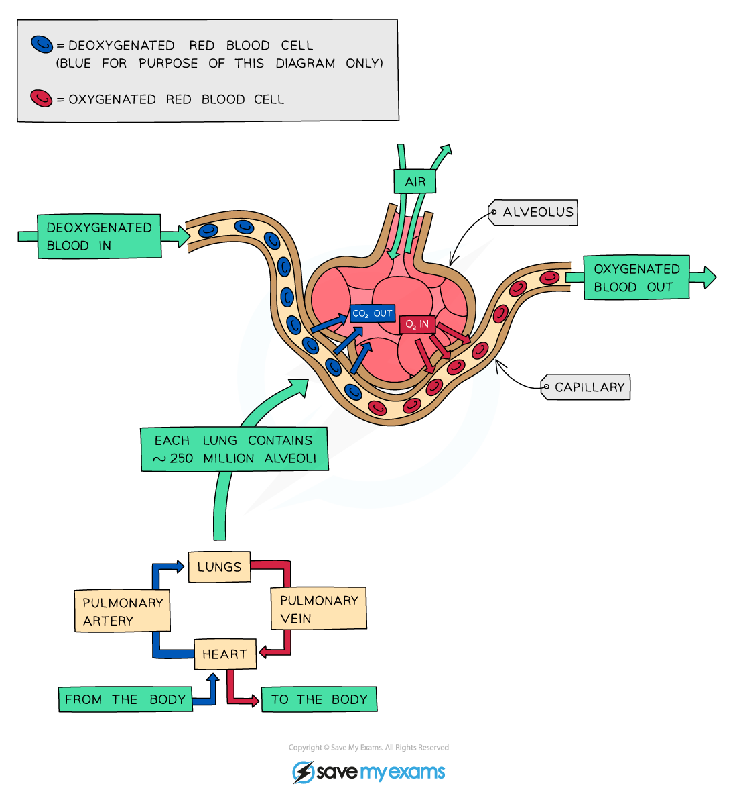

# Features of Gas Exchange Surfaces

## Features of gas exchange surfaces: Extended

> **Spec point** — `spcpt_p5x4WmxdDQBVgbzc` · Describe the features of gas exchange surfaces in humans, limited to: large surface area, thin surface, good blood supply and good ventilation with air

## Features of gas exchange surfaces: Extended

- All **gas exchange surfaces** have features in common
- These features maximise the rate of gas exchange taking place; they include:

  - **Large surface area** to allow faster diffusion of gases across the surface
  - **Thin walls** to ensure diffusion distances remain short
  - **Good ventilation with air** so that diffusion gradients can be maintained
  - **Good blood supply** to maintain a high concentration gradient so diffusion occurs faster

***The alveolus is the gas exchange surface in humans***

> **Exam Hint**
> You may notice that several of the features of alveoli that aid their function are the same as those that make villi, or root hair cells, suited to their function, e.g.
> 
> - large surface area
> - good blood supply
> - steep concentration gradient
> 
> These structures are all examples of **exchange surfaces**; they allow the efficient movement of substances across their surface by diffusion, active transport and/or osmosis. So, if you learn the features of one exchange surface, you also know the features of the others!
