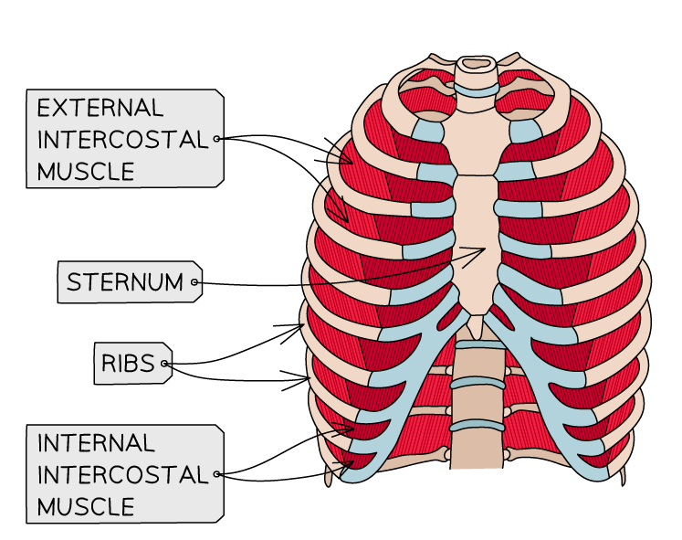

# The Breathing System

## The breathing system

> **Spec point** — `spcpt_jQ5FXjY4VB8Kvp7T` · Identify in diagrams and images the following parts of the breathing system: lungs, diaphragm, ribs, intercostal muscles, larynx, trachea, bronchi, bronchioles, alveoli and associated capillaries

## The breathing system

- The breathing system includes the following parts:

  - the lungs
  - diaphragm
  - ribs
  - intercostal muscles
  - larynx
  - trachea
  - bronchi
  - bronchioles
  - alveoli and associated capillaries

*Structures in the human breathing system*

*The internal and external intercostal muscles*

### Structures of the breathing system table

| Structure | Description |
|---|---|
| Ribs | Bone structure that protects internal organs such as the lungs |
| Intercostal muscle | Muscles between the ribs which control their movement, causing inhalation and exhalation |
| Diaphragm | Sheet of connective tissue and muscle at the bottom of the thorax that helps change the volume of the thorax to allow inhalation and exhalation |
| Trachea | Windpipe that connects the mouth and nose to the bronchi, allowing air to pass into the lungs |
| Larynx | Also known as the voice box; when air passes across here, we are able to make sounds |
| Bronchi (singular: bronchus) | Large tubes branching off the trachea, with one for each lung |
| Bronchioles | Bronchi split to form smaller tubes called bronchioles in the lungs, connected to alveoli |
| Alveoli | Tiny air sacs where gas exchange takes place |

> **Exam Hint**
> You should be able to identify in diagrams and images the parts of the breathing system listed above, so make sure you study them.
