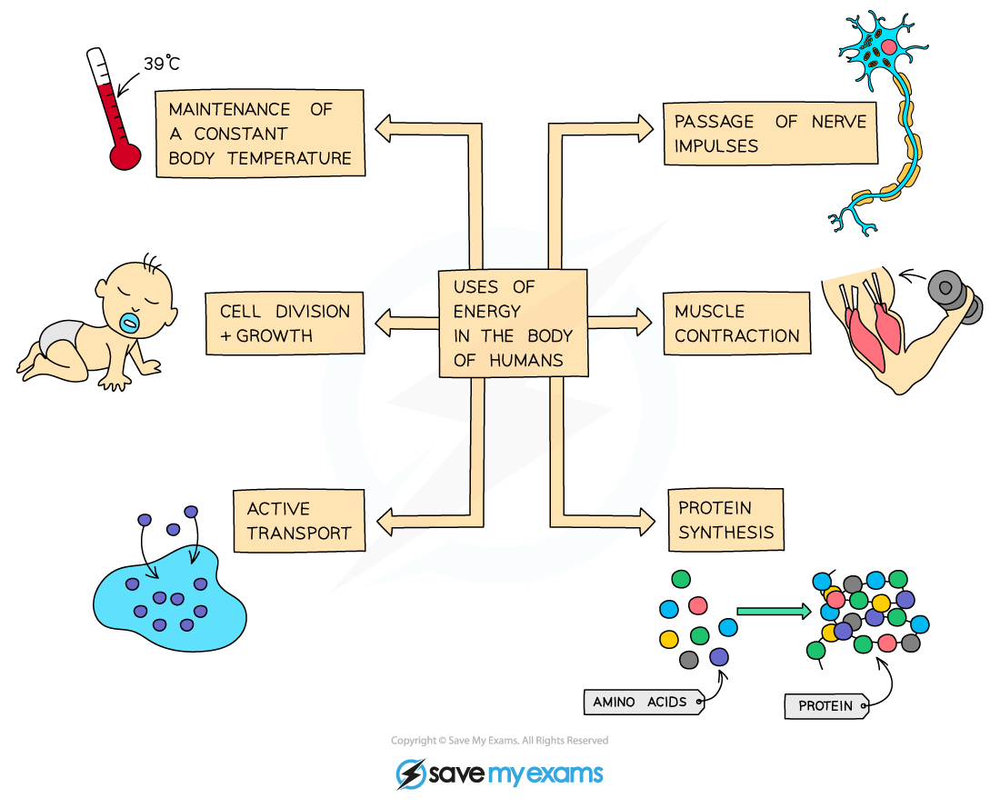

# Respiration in Cells

## Uses of energy in living organisms

> **Spec point** — `spcpt_GgKz6mdWVQbxksmM` · State the uses of energy in living organisms, including: muscle contraction, protein synthesis, cell division, active transport, growth, the passage of nerve impulses and the maintenance of a constant body temperature

## Uses of energy in living organisms

### What is respiration?

- Respiration is a chemical process that involves the breakdown of nutrient molecules (specifically glucose) in order to **release the energy** stored within the bonds of these molecules

  - Respiration is** enzyme-controlled**
- Respiration can take place with oxygen (**aerobically**) or without oxygen (**anaerobically**).

  - Much less energy is released for each glucose molecule broken down anaerobically compared to the energy released when it is broken down aerobically
- Respiration occurs **in all living cells**; most of the chemical reactions in aerobic respiration take place in the mitochondria

#### Uses of energy released in respiration

- Humans need the energy released during respiration to carry out many processes

  - Muscle contraction
  - Protein synthesis
  - Cell division (to make new cells)
  - Growth
  - Active transport across cell membranes
  - Generation of nerve impulses
  - Maintaining a constant internal body temperature

*The energy released during respiration is used to fuel many processes in the human body*

> **Exam Hint**
> Avoid the common misconception that respiration is breathing! Respiration is a series of **chemical reactions that** **release energy** from glucose inside cells. Be careful that you always state that energy is **released**, it is NEVER made, produce, or created.
> 
> The respiration reactions are all controlled by enzymes. You need to be able to state this in an exam!
