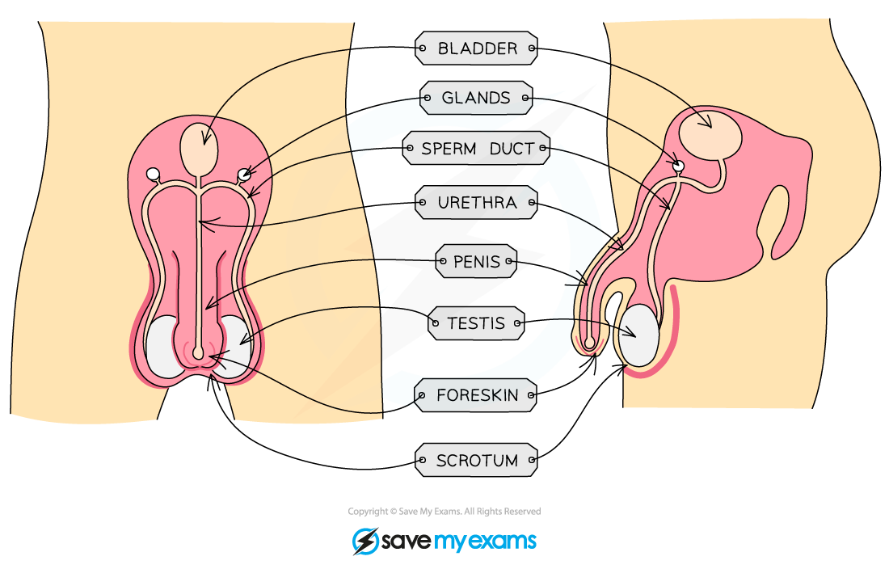

# Sexual Reproduction in Humans

## The Male Reproduction System

> **Spec point** — `spcpt_nW8W5XSV5BCDcFNT` · nan

## The male reproductive system

### Structures of the male reproductive system

- The male reproductive system has several key components
- The structure and function of these components can be seen in the table below

| **Structure** | **Function** |
|---|---|
| Prostate gland | Produces a fluid  that mixes with sperm cells to form semen |
| Sperm duct | Sperm passes through the sperm duct to be mixed with fluids produced by the glands before being passed into the urethra for ejaculation |
| Urethra | Tube running down the centre of the penis that can carry out urine or semen, a ring of muscle in the urethra prevents the urine and semen from mixing |
| Testis | Contained within a bag of skin (scrotum) and produces sperm (male gamete) and testosterone hormone |
| Scrotum | Sac supporting the testes outside the body to ensure that sperm are kept at a temperature slightly lower than body temperature |
| Penis | Passes urine out of the body from the bladder and allows semen to pass into the vagina of a woman during sexual intercourse |

#### The male reproductive system diagram

***The male reproductive system***

## The Female Reproduction System

> **Spec point** — `spcpt_gk6sdsQ7qR4s4xzq` · nan

## The female reproductive system

### Structures of the female reproductive system

- The female reproductive system has several key components
- The structure and function of these components can be seen in the table below

| **Structure** | **Function** |
|---|---|
| Oviduct | Connects the ovary to the uterus and is lined with ciliated cells to push the released ovum down it. Fertilisation occurs here |
| Ovary | Contains ova (female gametes) which will mature and develop when hormones are released |
| Uterus | Muscular bag with a soft lining where the fertilised egg (zygote) will be implanted to develop into a foetus |
| Cervix | Ring of muscle at the lower end of the uterus to keep the developing foetus in place during pregnancy |
| Vagina | The muscular tube that leads to the inside of the woman's body where the males penis will enter during sexual intercourse and sperm are deposited |

#### The female reproductive system diagram

***The female reproductive system***

## Gametes & Fertilisation

> **Spec point** — `spcpt_28BdtFbpKjzh5VdM` · Describe fertilisation as the fusion of the nuclei from a male gamete (sperm) and a female gamete (egg cell)

## Gametes & Fertilisation

### What is fertilisation?

- Fertilisation is the **fusion of the nuclei from a male gamete (sperm cell) and a female gamete (egg cell)**
- It occurs in the **oviducts**
- Gametes have **adaptations** to increase the chances of fertilisation and successful development of an embryo

#### Fertilisation diagram

***The sperm enters the egg cell during fertilisation which usually occurs in the oviduct***
