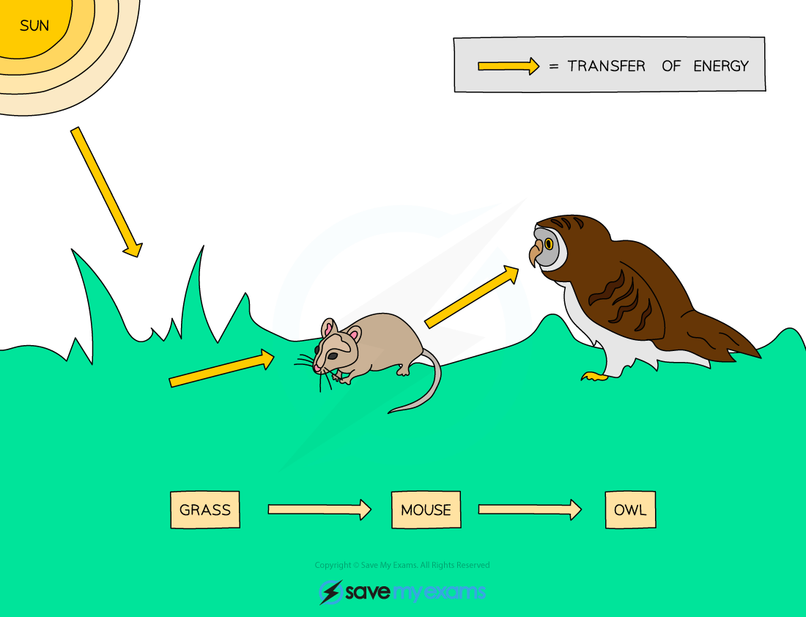

# Food Chains & Food Webs

## Food chains & food webs

> **Spec point** — `spcpt_qVv4n2TnyPDrjvdM` · Describe a food chain as showing the transfer of energy from one organism to the next, beginning with a producer
Describe a producer as an organism that makes its own organic nutrients, usually using energy from sunlight, through photosynthesis
Describe a consumer as an organism that gets its energy by feeding on other organisms
State that consumers may be classed as primary, secondary, tertiary and quaternary according to their position in a food chain
Describe a herbivore as an animal that gets its energy by eating plants
Describe a carnivore as an animal that gets its energy by eating other animals
Describe a decomposer as an organism that gets its energy from dead or waste organic material
Construct and interpret simple food chains Describe a food web as a network of interconnected food chains and interpret food webs
Use food chains and food webs to describe the impact humans have through overharvesting of food species and through introducing foreign species to a habitat

## Food chains & food webs

| Term | Definition |
|---|---|
| Producers | Organisms that produce their own organic nutrients, usually using energy from sunlight. Plants are producers as they carry out photosynthesis to make glucose |
| Consumers | An organism that gets its energy by feeding on other organisms.  Consumers may be classed as primary, secondary, tertiary and quaternary according to their position in a food chain. |
| Herbivore | An animal that gets its energy by eating plants |
| Carnivore | An animal that gets its energy by eating other animals |
| Decomposers | An organism that gets its energy from dead or waste organic material |

*A food chain with three trophic levels*

- A food chain shows the transfer of energy from one organism to the next, starting with a producer
- The source of all energy in a food chain is **light energy from the Sun**
- The arrows in a food chain show the **transfer of energy** from one trophic level to the next
- Energy is transferred from one organism to another by ingestion (eating)
- In the food chain above:

#### Food chain example table

| **Position in food chain** | **Organism** | **Explanation** |
|---|---|---|
| Producer | Grass | Makes its own food using energy from sunlight in photosynthesis |
| Primary consumer | Mouse | Eats the producer |
| Secondary consumer | Barn owl | Eats the primary consumer |

### Food webs

- A **food web** is a network of interconnected food chains
- Food webs are more realistic ways of showing connections between organisms within an ecosystem as **animals rarely exist on just one type of food source**

*A food web shows the interdependence of organisms*

- Food webs give more information about the transfer of energy in an ecosystem
- They also show **interdependence** - how the change in one population can affect others within the food web
- For example, in the food web above, if the **population of earthworms decreased**:

  - the population of **grass plants would increase** as there are now fewer species feeding off them
  - the populations of **frogs and mice would decrease significantly** as earthworms are their only food source
  - the population of **sparrows would decrease slightly** as they eat earthworms but also have another food source to rely on (caterpillars)
- Most of the changes in populations of animals and plants happen as a result of **human impact** - either by **overharvesting of food species** or by the **introduction of foreign species to a habitat**
- Due to interdependence, these can have **long-lasting knock-on effects** to organisms throughout a food chain or web

> **Exam Hint**
> Questions about interdependence in food webs are common and easy to gain marks on if you answer them fully and correctly.
> 
> Do not say an animal or plant would ‘die out’ as this is unlikely to happen – stick to using the words decrease or increase. If in doubt, always give your reason for the increase or decrease in population.
