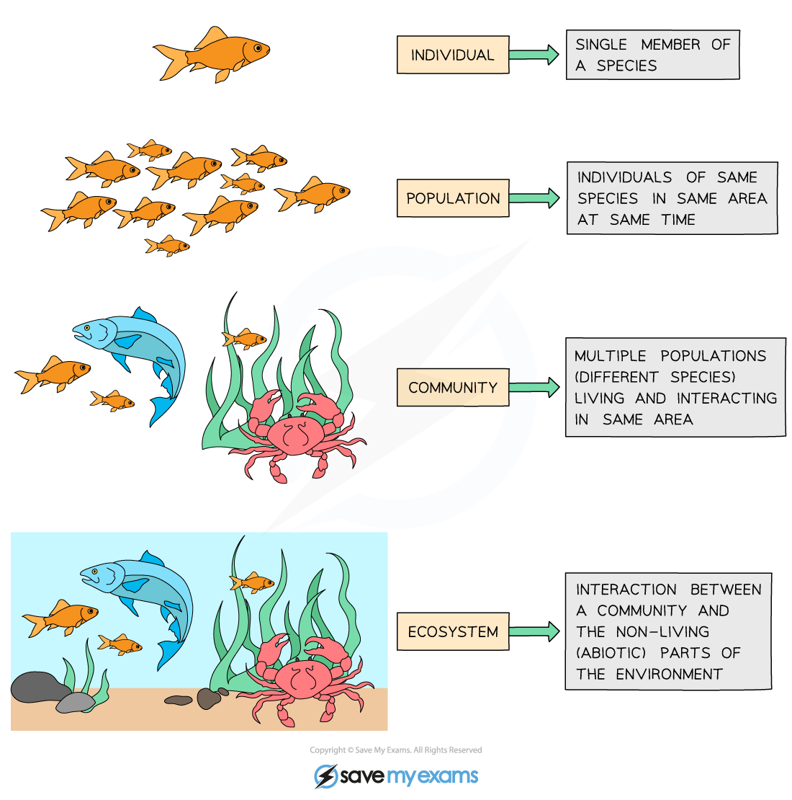
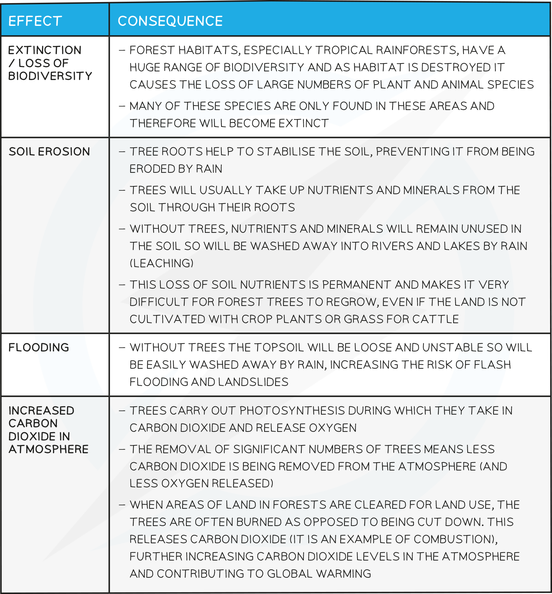

# The Importance of Biodiversity

## Human Pressures on Other Species

> **Spec point** — `spcpt_6b9mKQghNvfQhxrc` · Describe biodiversity as the number of different species that live in an area
Describe the reasons for habitat destruction, including:
(a) increased area for housing, crop plant production and livestock production
(b) extraction of natural resources
(c) freshwater and marine pollution
State that through altering food webs and food chains, humans can have a negative impact on habitats
Explain the undesirable effects of deforestation as an example of habitat destruction, to include: reducing biodiversity, extinction, loss of soil, flooding and increase of carbon dioxide in the atmosphere

## Human Pressures on Other Species

#### Ecosystems

- **An ecosystem** is a unit containing the *community* of organisms and their environment, interacting together
- Ecosystems can **vary greatly in size and scale**

  - A small ecosystem might be a garden pond, whilst a large ecosystem might be the whole of Antarctica

*Levels of organisation in an ecosystem*

#### Biodiversity

- Is defined as the **number of different species** that live in a particular area
- Human activities have tended to **force biodiversity downwards**, whereas, high biodiversity is needed for stable ecosystems
- **Habitat destruction** by humans is a major downward pressure on biodiversity

#### Reasons for Habitat Destruction

- The increasing human population of the planet is causing destruction of many habitats from rainforest to woodland to marine
- Many habitats are destroyed by humans to make space for other economic activities, or by pollution from these activities, and this reduces the biodiversity of these areas
- This interrupts food chains and webs, meaning that more species may die because their prey is gone
- The main reasons for habitat destruction include:

#### Deforestation

- Deforestation is the **clearing of trees** (usually on a large scale)
- If trees are replaced by replanting it can be a **sustainable** practise
- Generally the trees are being cleared for the **land to be used in a different way** (for building, grazing for cattle, planting of monocultures such as palm oil plantations etc) and therefore it is not sustainable
- As the amount of the Earth’s surface covered by trees decreases, it causes increasingly negative effects on the environment and is a **particularly severe example of habitat destruction**
- Undesirable effects of deforestation include:

  - **Extinction** of species
  - Loss of **soil**
  - **Flooding**
  - Increase of **carbon dioxide** in the atmosphere

