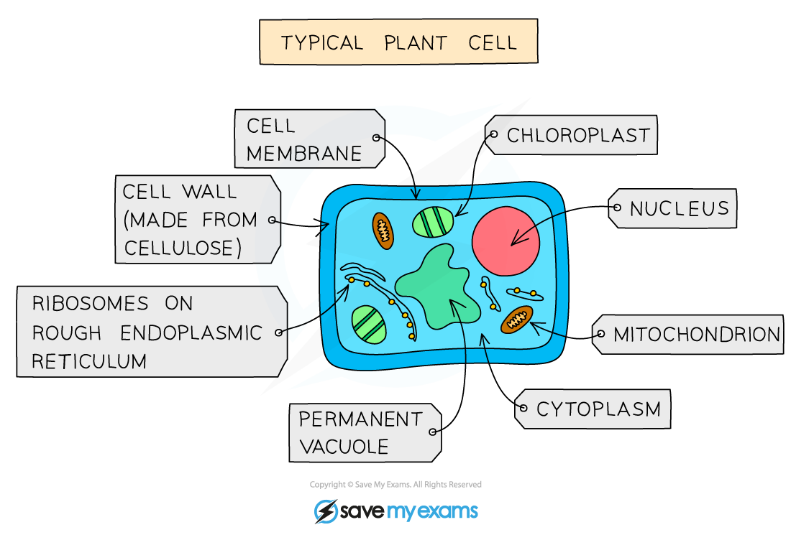
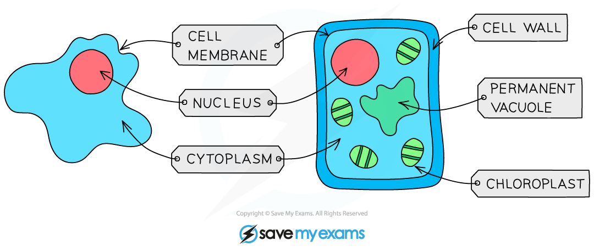

# Cell Structure

## Animal & plant cells

> **Spec point** — `spcpt_Smzm56zRCYyG6zfQ` · Describe and compare the structure of a plant cell with an animal cell, limited to: cell wall, cell membrane, nucleus, cytoplasm, chloroplasts, ribosomes, mitochondria, vacuoles

## Animal & plant cells

### Animal cell structure

- **The main features of animal cells:**

  - they contain a **nucleus** with a **distinct membrane**
  - **cells do not** have **cellulose cell walls**
  - their cells **do not** contain **chloroplasts** (so they **are unable** to carry out **photosynthesis**)
  - they contain carbohydrates stored as **glycogen**

#### Animal cell diagram

*A typical animal cell*

### Plant cell structure

- **The main features of plant cells:**

  - they contain a **nucleus** with a **distinct membrane**
  - cells have **cell walls** made out of **cellulose**
  - they contain **chloroplasts** (so they can carry out **photosynthesis**)
  - carbohydrates are stored as **starch** or **sucrose**

#### Plant cell diagram

*A typical plant cell*

### Animal and plant cell structure and function table

| **Structure** | **Function** |
|---|---|
| Nucleus | - Contains the DNA (genetic material) which controls the activities of the cell |
| Cytoplasm | - A gel like substance composed of water and **dissolved solutes** - Supports the internal structures of the cell - Site of many **chemical reactions** (including anaerobic respiration) |
| Cell membrane | - Holds the cell together separating the inside of the cell from the outside - Controls which substances** enter or leave** the cell |
| Ribosomes | - Found in the cytoplasm - The site of **protein synthesis** |
| Mitochondria | - The site of **aerobic respiration** |

### Cell structure diagram

*An animal and plant cell as seen under a light microscope*

### Additional plant cell structure and function table

| **Structure** | **Function** |
|---|---|
| Cell wall | - Made of **cellulose **(a polymer of glucose) - Gives the cell extra **support**, defining its shape |
| Chloroplast | - Contains the green **chlorophyll **pigment that absorbs light energy for **photosynthesis** |
| Permanent vacuole | - Contains **cell sap**: a solution of sugar and salt - Used for storage of certain materials - Helps to **support **the shape of the cell |

## Bacteria cells

> **Spec point** — `spcpt_sjR3TQ77JH6BrvHw` · Describe the structure of a bacterial cell, limited to: cell wall, cell membrane, cytoplasm, ribosomes, circular DNA, plasmids

## Bacteria cells

### Bacteria cell structure

- Bacteria, which have a wide variety of shapes and sizes, all share the following biological characteristics:

  - they are **microscopic single-celled organisms**
  - possess a **cell wall** (made of **peptidoglycan**, not cellulose), **cell membrane**, **cytoplasm** and **ribosomes**
  - **lack a nucleus** but contain a **circular chromosome of DNA that floats in the cytoplasm**
  - ***plasmids*** are sometimes present - these are **small rings of DNA** (also floating in the cytoplasm) that contain **extra genes** to those found in the chromosomal DNA
  - they** lack mitochondria, chloroplasts and other membrane-bound organelles** found in animal and plant cells
- Some bacteria also have a **flagellum** (singular) or **several flagella** (plural). These are **long, thin, whip-like tails** attached to bacteria that allow them to **move**
- Examples of bacteria include:

  - ***Lactobacillus*** (a rod-shaped bacterium used in the production of yoghurt from milk)
  - ***Pneumococcus*** (a spherical bacterium that acts as the pathogen causing pneumonia)

#### Bacteria cell diagram

*A typical bacterial cell*

## Identifying cell structures & function

> **Spec point** — `spcpt_rrbnjSkPB3h5YGQP` · Identify the cell structures listed in diagrams and images of plant, animal and bacterial cells
Describe the functions of the structures in plant, animal and bacterial cells

## Identifying cell structures & function

- Within the cytoplasm, the following organelles are visible in almost all cells except prokaryotes when looking at higher magnification (ie using an electron microscope):

  - **mitochondria** (singular: mitochondrion) are organelles found throughout the cytoplasm
  - **ribosomes** are tiny structures that can be free within the cytoplasm or attached to a system of membranes within the cell known as **endoplasmic reticulum**
  - Endoplasmic reticulum studded with ribosomes looks **rough** under the microscope; this gives rise to its name of **rough endoplasmic reticulum** (often shortened to **R.E.R.**)
  - **vesicles** can also be seen using a higher magnification - these are small circular structures found moving throughout the cytoplasm

### Identifying cell structures under a microscope

*Structures in an animal cell visible under a light microscope and an electron microscope*

*Structures in a plant cell visible under a light microscope and an electron microscope*
