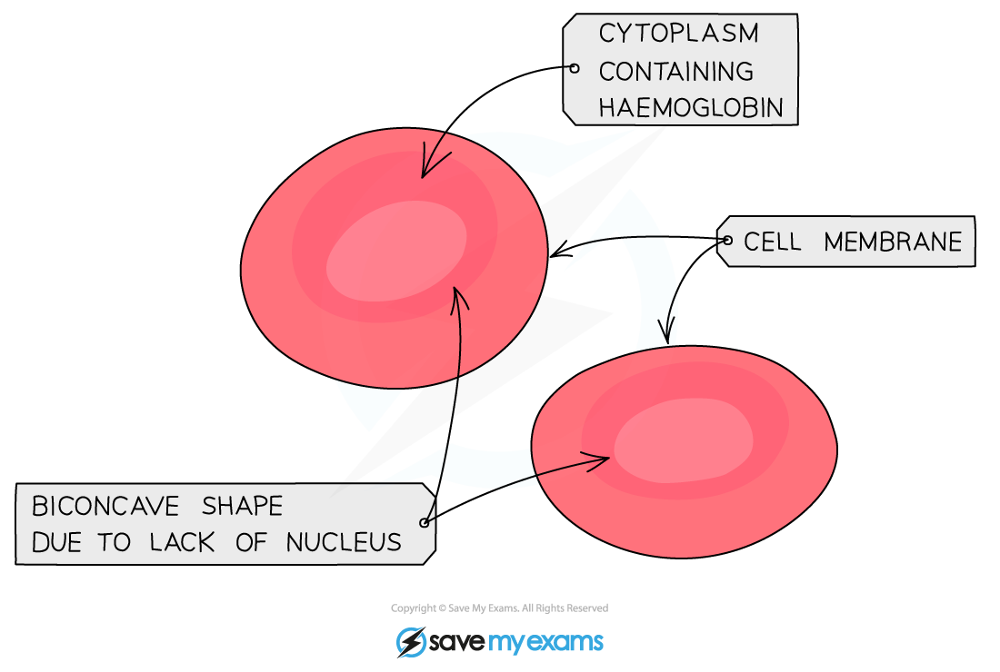
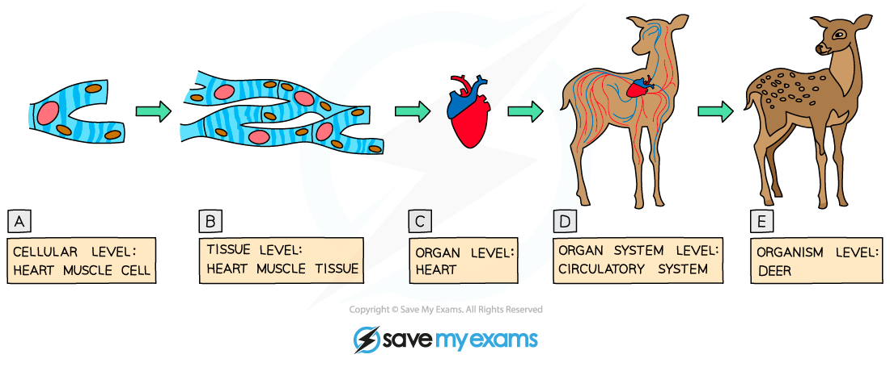
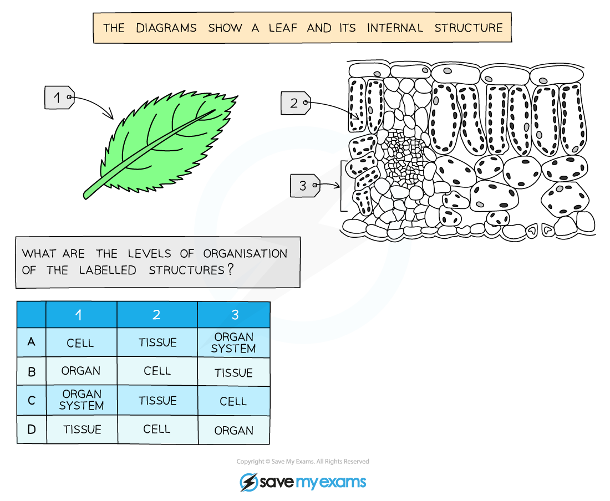

# Organisation of Cells

## Specialised Cells: Extended

> **Spec point** — `spcpt_R9hjh6Zvk49FmmWJ` · State that specialised cells have specific functions, limited to:
(a) ciliated cells – movement of mucus in the trachea and bronchi
(b) root hair cells – absorption
(c) palisade mesophyll cells – photosynthesis
(d) neurones – conduction of electrical impulses
(e) red blood cells – transport of oxygen
(f) sperm and egg cells (gametes) – reproduction

## Specialised Cells: Extended

#### Specialised cells in animals and plants

- Specialised cells are those which have **developed certain characteristics** in order to **perform particular functions**. These differences are controlled by genes in the nucleus
- Cells specialise by undergoing **differentiation**: this is a process by which cells develop the structure and characteristics needed to be able to carry out their functions
- The table shows some examples of specialised cells in animals and plants

| **Cell** | **Function** | **Adaptations** |
|---|---|---|
| **Root hair cell (plant)** | Absorption of water and mineral ions from soil | • Root hair increases surface area of the cell to ensure maximum absorption of water and mineral ions  • Walls are thin to ensure water moves through quickly  • No chloroplasts present |
| **Palisade mesophyll cell (plant)** | Photosynthesis | • Column shaped to maximize absorption of sunlight and fit as many in a layer under the upper epidermis of the leaf as possible  • Contains many chloroplasts for maximum photosynthesis |
| **Red blood cell (animal)** | Transport of oxygen | • Biconcave disc shape increases surface area for more efficient diffusion of oxygen  • Contains haemoglobin which joins with oxygen to transport it  • Contains no nucleus to increase amount of space available for haemoglobin inside the cell |

**Diagrams of specialised cells in animals and plants:**

*Root hair cell*

*Palisade mesophyll cell*

*Red blood cells*

## Levels of Organisation in an Organism

> **Spec point** — `spcpt_rMKjZv3QFJhChR46` · Describe the meaning of the terms: cell, tissue, organ, organ system and organism as illustrated by examples given in the syllabus

## Levels of Organisation in an Organism

***Levels of organisation***

- Your syllabus states that you should be able to identify the different levels of organisation in drawings, diagrams and images of familiar material
- An example of this is shown in the exam question below:

***Typical levels of organisation question***

> **Exam Hint**
> Most incorrect answers here come from not being able to identify a tissue, so it’s worth making sure you understand and remember that **tissues are always made up of only one type of cell**.
