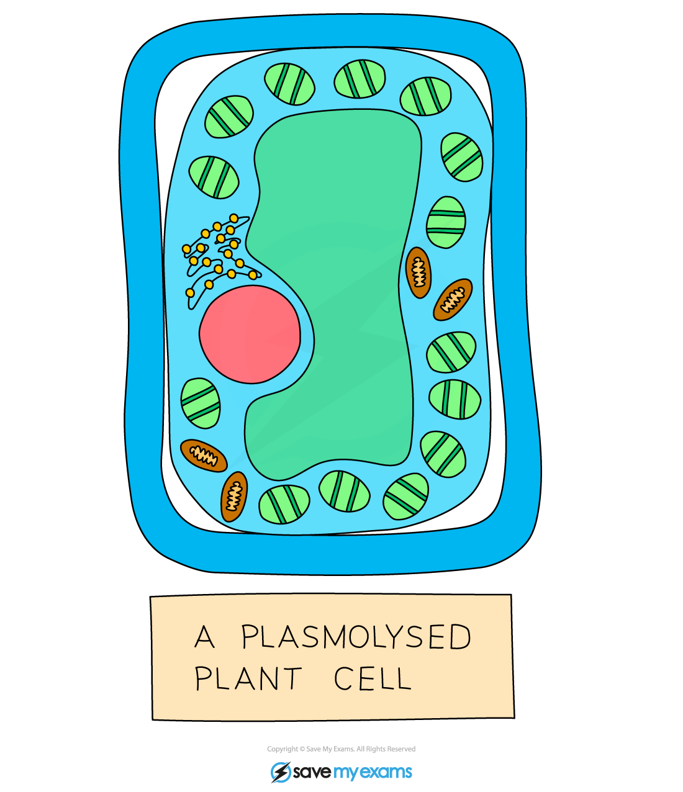

# Osmosis in Plants

## Osmosis in Plants: Extended

> **Spec point** — `spcpt_hk9bxkKFXKjbGKKF` · Explain the effects on plant cells of immersing them in solutions of different concentrations by using the terms: turgid, turgor pressure, plasmolysis, flaccid

## Osmosis in Plants: Extended

#### Plant cells in solutions of different concentrations

- When plant cells are placed in a solution that has a **higher water potential **(dilute solution) than inside the cells (e.g. distilled water) then water moves into the plant cells via osmosis
- These water molecules push the cell membrane against the cell wall, increasing the **turgor pressure** in the cells which makes them **turgid**

***A turgid plant cell***

- When plant cells are placed in a **concentrated** solution (with a lower water potential than inside the cells) water molecules will move **out of the plant cells by osmosis**, making them flaccid

  - If plant cells become flaccid it can negatively affect the plant's ability to support itself
- If looked at underneath the microscope, the plant cells might be **plasmolysed**, meaning the cell membrane has pulled away from the cell wall

***A plasmolysed plant cell***
