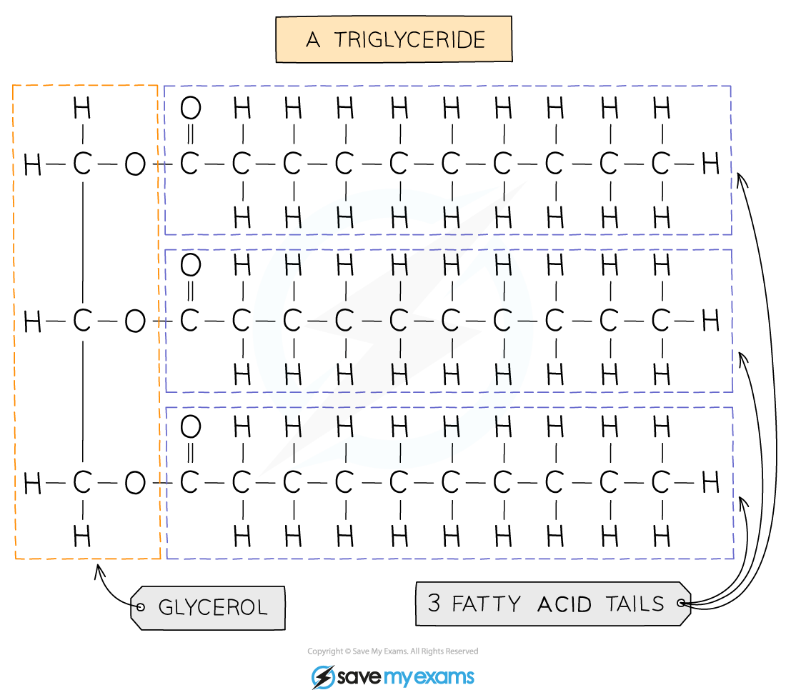

# Chemicals & Life

## Chemical elements

> **Spec point** — `spcpt_HsnR4d9Hj4fwMTdq` · List the chemical elements that make up: carbohydrates, fats and proteins

## Chemical elements

- Most of the molecules in living organisms fall into three categories: **carbohydrates, proteins and lipids**
- These **all contain carbon** and so are described as organic molecules

### Chemical elements table

| Molecule | Chemical elements |
|---|---|
| Carbohydrate | - Carbon (C) - Oxygen  (O) - Hydrogen (H) |
| Protein | All contain:  - Carbon (C) - Oxygen  (O) - Hydrogen (H) - Nitrogen (N)  Some contain small amounts of other elements, for example:  - Sulfur (S) - Selenium (Se) |
| Lipid | - Carbon (C) - Oxygen  (O) - Hydrogen (H) |

## Large molecules are made from smaller molecules

> **Spec point** — `spcpt_4MmQW2b72kbzmVGn` · State that large molecules are made from smaller molecules, limited to:
(a) starch, glycogen and cellulose from glucose
(b) proteins from amino acids
(c) fats and oils from fatty acids and glycerol

## Large molecules are made from smaller molecules

### Carbohydrates

- Long chains of **simple sugars  **(monosaccharides)
- **Glucose** is a simple sugar
- When **two glucose molecules join together maltose is formed** (a disaccharide)
- When **lots** of glucose molecules join together **starch, glycogen or cellulose** can form (a polysaccharide)

*Glycogen, cellulose and starch are all made from glucose molecules*

### Fats

- Most fats (lipids) in the body are made up of **triglycerides**
- Their basic unit is **one glycerol molecule chemically bonded to three fatty acid chains**
- The fatty acids vary in size and structure
- Lipids are divided into **fats** (solids at room temperature) and **oils** (liquids at room temperature)

*Structure of a triglyceride*

### Proteins

- Long chains of **amino acids**
- There are about 20 different amino acids
- They all contain the **same basic structure** but the **‘R’ group is different for each one**
- When amino acids are joined together a protein is formed
- The amino acids can be arranged in any order, resulting in hundreds of thousands of different proteins
- Even a small difference in the order of the amino acids results in a different protein being formed

*General amino acid structure*

*Amino acids join together to form proteins*
