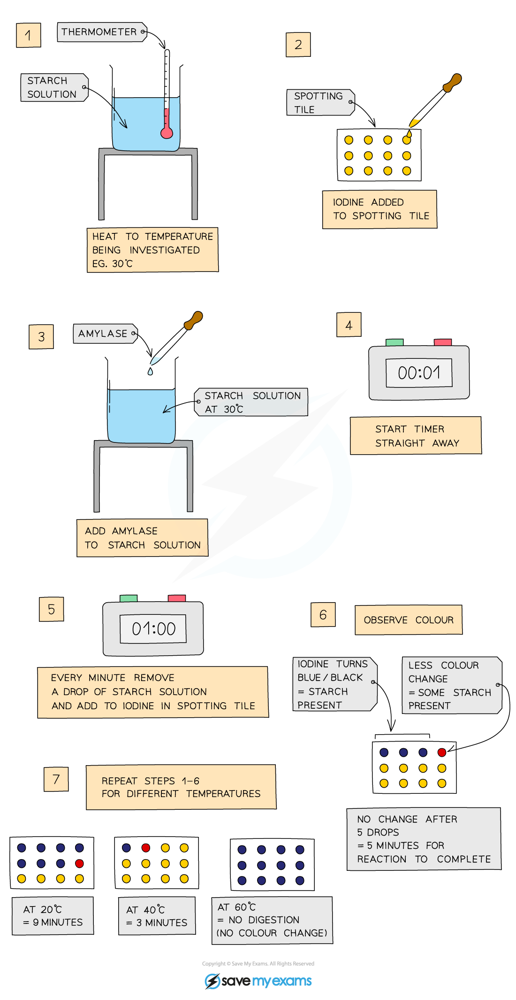

# Enzyme Investigations

## Investigating the effect of temperature on amylase

> **Spec point** — `spcpt_BFvYxZfm4TbkN8g3` · Investigate and describe the effect of changes in temperature and pH on enzyme activity with reference to optimum temperature and denaturation

## Investigating the effect of temperature on amylase

- **Starch solution** is heated to a set temperature
- **Iodine** is added to wells of a spotting tile
- **Amylase** is added to the starch solution and mixed well
- Every minute, droplets of solution are added to a new well of iodine solution
- This is continued until the iodine **stops turning blue-black** (this means there is **no more starch** left in the solution as the amylase has broken it all down)
- Time taken for the reaction to be completed is recorded
- Experiment is repeated at different temperatures
- The quicker the reaction is completed, the faster the enzyme is working

*Investigating the effect of temperature on enzyme activity*

## Investigating the effect of pH on amylase

> **Spec point** — `spcpt_YJTG6Y6pw9B5ZW4k` · Investigate and describe the effect of changes in temperature and pH on enzyme activity with reference to optimum temperature and denaturation

## Investigating the effect of pH on amylase

- Place single drops of **iodine** solution in rows on the tile
- Label a test tube with the pH to be tested
- Use the syringe to place 2 cm3 of **amylase** in the test tube
- Add 1 cm3 of **buffer solution** to the test tube using a syringe
- Use another test tube to add 2 cm3 of **starch solution** to the amylase and buffer solution, start the stopwatch whilst mixing using a pipette
- After 10 seconds, use a pipette to place one drop of mixture on the first drop of iodine, which should turn blue-black
- Wait another 10 seconds and place another drop of mixture on the second drop of iodine
- Repeat every 10 seconds **until iodine solution remains orange-brown**
- Repeat experiment at different pH values - the less time the iodine solution takes to remain orange-brown, the quicker all the starch has been digested and so the better the enzyme works at that pH

*Investigating the effect of pH on enzyme activity*

> **Exam Hint**
> Describing and explaining experimental results for enzyme experiments is a common type of exam question so make sure you understand what is happening and, for the top grades, can relate this to changes in the active site of the enzyme when it has denatured, or if it is a **low temperature**, relate it to the amount of kinetic energy the molecules have.
