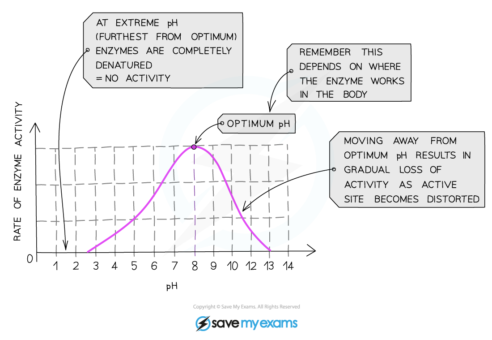

# Enzymes & pH

## Enzymes & pH: Extended

> **Spec point** — `spcpt_KBdC2wDzfPD3qj46` · Explain the effect of changes in pH on enzyme activity in terms of shape and fit and denaturation

## Enzymes & pH: Extended

### Extended Tier Only

- The optimum pH for most enzymes is 7 but some that are produced in acidic conditions, such as the stomach, have a lower optimum pH (pH 2) and some that are produced in alkaline conditions, such as the duodenum, have a higher optimum pH (pH 8 or 9)
- If the pH is too high or too low, the bonds that hold the amino acid chain together to make up the protein can be destroyed
- This will change the shape of the active site, so the substrate can no longer fit into it, reducing the rate of activity
- Moving too far away from the optimum pH will cause the enzyme to denature and activity will stop

*Effect of pH on enzyme activity*

*Graph showing the effect of pH on rate of activity for an enzyme from the duodenum*
