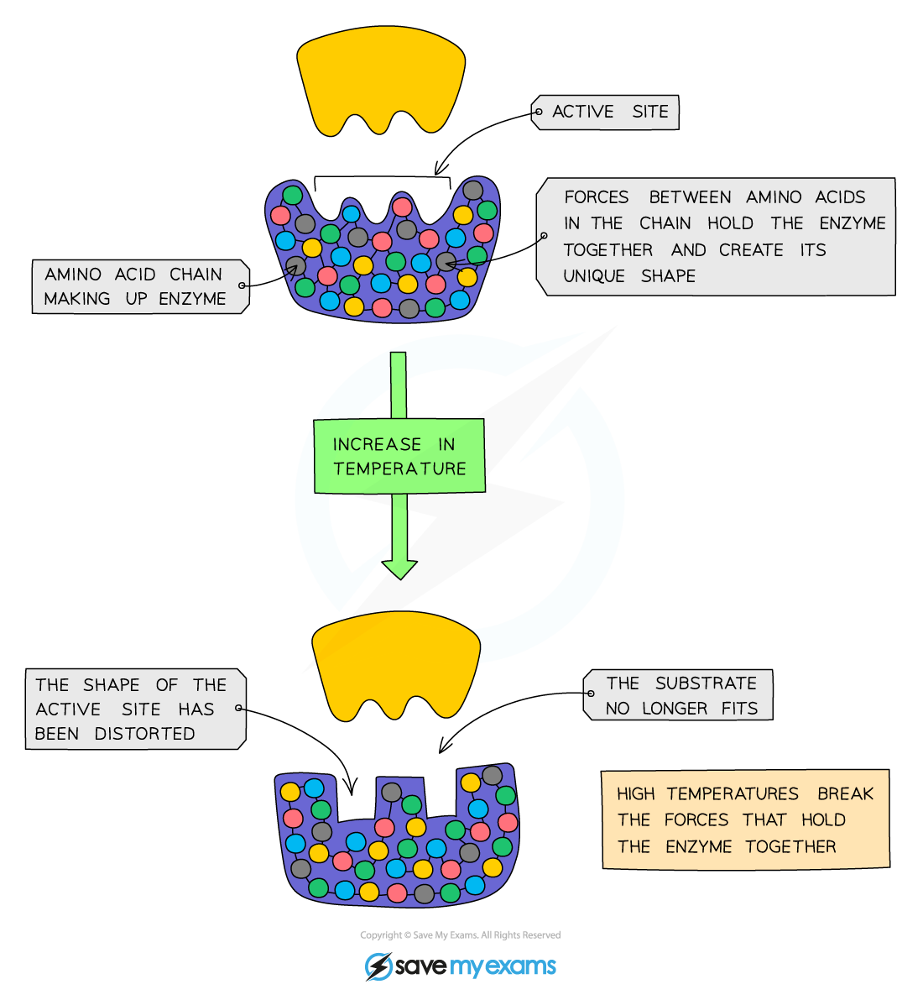
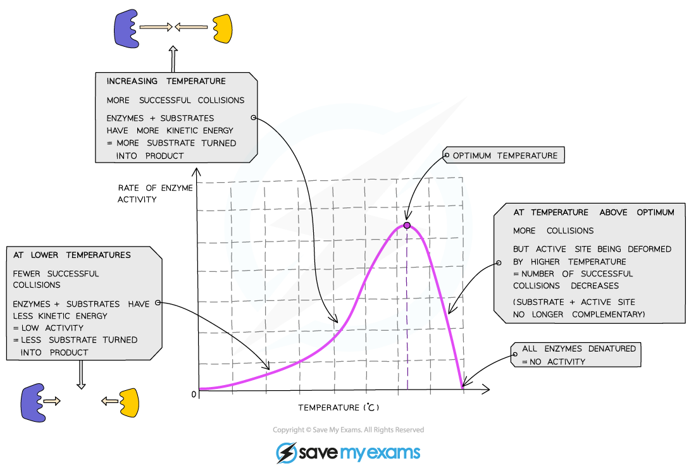

# Enzymes & Temperature

## Enzymes & temperature: Extended

> **Spec point** — `spcpt_bWFsrk7vr3qVsrjn` · Explain the effect of changes in temperature on enzyme activity in terms of kinetic energy, shape and fit, frequency of effective collisions and denaturation

## Enzymes & temperature: Extended

### Extended Tier Only

- Enzymes are **proteins** and have a **specific shape**, held in place by **bonds**
- This is extremely important around the **active site** area as the specific shape is what ensures the **substrate will fit into the active site** and enable the reaction to proceed
- Enzymes work fastest at their ‘**optimum temperature**’ – in the human body, the optimum temperature is 37 °C
- Heating to high temperatures (beyond the optimum) **breaks the bonds** that hold the enzyme's structure together, causing it to lose its shape
- This changes the shape of the active site so it's no longer complementary to the substrate, and the enzyme is **denatured**
- Substrates cannot fit into denatured enzymes as the shape of their active site has been lost
- Denaturation is **irreversible** - once enzymes are denatured they cannot regain their proper shape and activity will stop

*Effect of temperature on enzyme activity*

- Increasing the temperature from 0 °C to the optimum increases the activity of enzymes as **the more energy the molecules have the faster they move and the number of collisions with the substrate molecules increases**, leading to a faster rate of reaction
- This means that **low temperatures do not denature enzymes**, they just make them work more slowly

*Graph showing the effect of temperature on the rate of enzyme activity*
