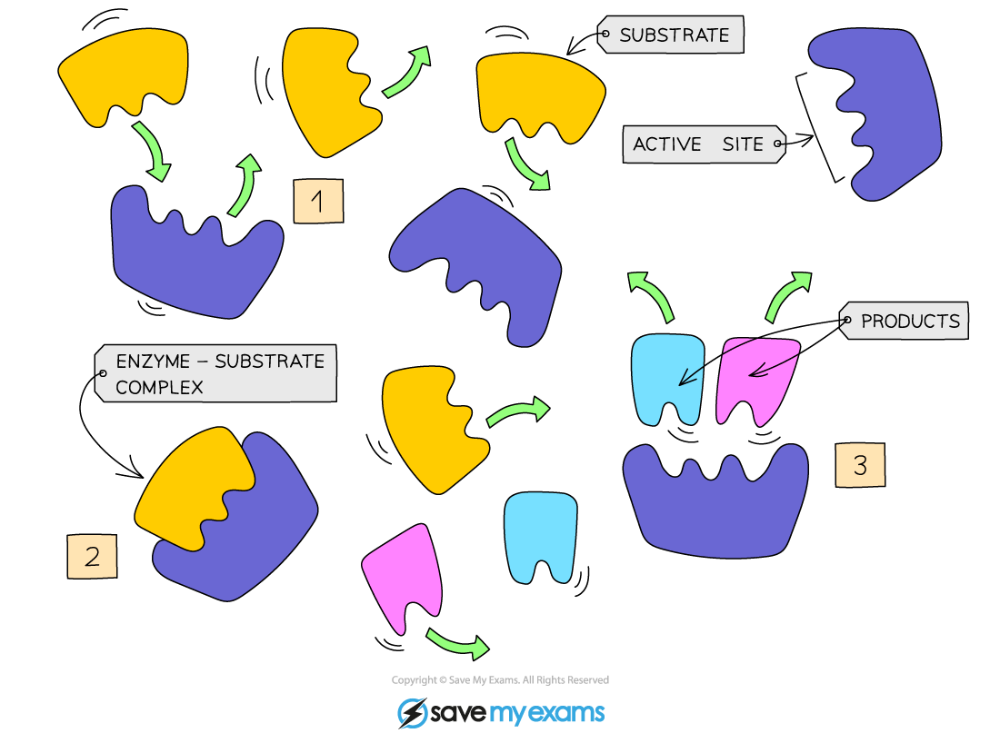

# Enzymes

## What are enzymes?

> **Spec point** — `spcpt_6KbHKNwyDVPqZCR7` · Describe enzymes as proteins that are
involved in all metabolic reactions, where they
function as biological catalysts

## What are enzymes?

- Enzymes are:

  - **Proteins**
  - **Biological catalysts** (biological because they are **made in living cells**, catalysts because they speed up the rate of chemical reactions without being changed)
  - Necessary to all living organisms as they **maintain reaction speeds** of all metabolic reactions (all the reactions that keep an organism alive)

## How do enzymes work?: Extended

> **Spec point** — `spcpt_Pt2cGffwKMxgTkTB` · Describe and explain enzyme action with
reference to: the active site, enzymesubstrate complex, substrate and product
4 Describe and explain the specificity of
enzymes in terms of the complementary
shape and fit of the active site with the
substrate

## How do enzymes work?: Extended

***Enzyme substrate specificity***

- Enzymes are **specific** to one particular substrate (molecule/s that get broken down or joined together in the reaction) as the enzyme is a complementary shape to the substrate
- The product is made from the substrate(s) and is released

***Enzyme specificity: lock and key model of enzyme activity***
