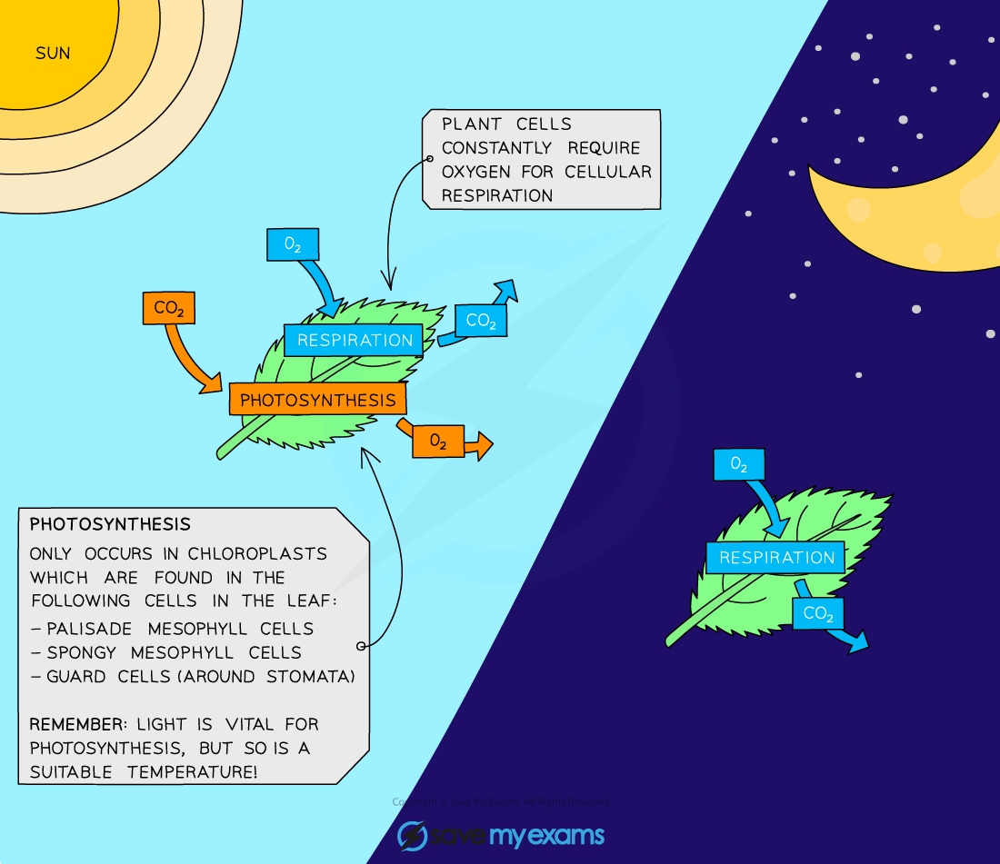

# Investigating Gas Exchange

## Investigating Gas Exchange: Extended

> **Spec point** — `spcpt_r6GKBxmDvcgtwQBs` · Investigate and describe the effect of light and dark conditions on gas exchange in an aquatic plant using hydrogencarbonate indicator solution

## Investigating Gas Exchange: Extended

- Plants are **respiring all the time** and so plant cells are **taking in oxygen and releasing carbon dioxide** as a result of aerobic respiration
- Plants also **photosynthesise during daylight** hours, for which they need to **take in carbon dioxide and release the oxygen **made in photosynthesis
- At night, plants do not photosynthesise but they continue to respire, meaning they **take in oxygen and give out carbon dioxide**

***Photosynthesis and respiration in plants***

- During the day, especially when the sun is bright, **plants are photosynthesising at a faster rate than they are respiring**, so there is a **net intake of carbon dioxide and a net output of oxygen**
- We can investigate the effect of light on the **net gas exchange** in an aquatic plant using a **pH indicator** such as **hydrogencarbonate indicator**
- This is possible because carbon dioxide is an **acidic gas** when dissolved in water
- Hydrogencarbonate indicator shows the **carbon dioxide concentration in solution**
- The table below shows the **colour** that the indicator turns at **different levels of carbon dioxide concentration** 
- Several leaves from the same plant are placed in stoppered boiling tubes containing some **hydrogencarbonate indicator**
- The effect of light can then be investigated over a period of a few hours
- Results from a typical experiment are shown in the table below:

