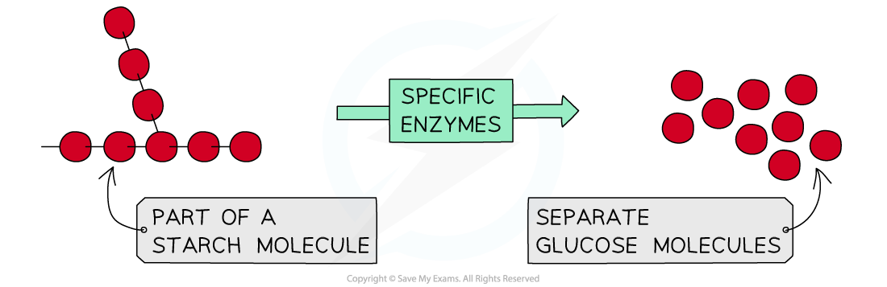

# Chemical Digestion

## Chemical Digestion

> **Spec point** — `spcpt_S4zSGXtpDWsmPZdD` · Describe chemical digestion as the break down of large insoluble molecules into small soluble molecules
State the role of chemical digestion in producing small soluble molecules that can be absorbed

## Chemical Digestion

- Chemical digestion is the** breakdown of large insoluble molecules** into **small soluble molecules**

  - E.g., starch is broken down into simple sugars using the enzyme amylase
- **Enzymes **are required for chemical digestion to take place

*Chemical digestion involves the breakdown of large insoluble molecules into small soluble molecules for absorption*

## Chemical Digestion & Absorption: Extended

> **Spec point** — `spcpt_SHd8R23DCG9GmNyZ` · State the role of chemical digestion in
producing small soluble molecules that can
be absorbed

## Chemical Digestion & Absorption: Extended

- Chemical digestion is required because large insoluble molecules are **unable to be absorbed **through the wall of the small intestines
- Small soluble molecules produced from chemical digestion, are **easily absorbed** into the surrounding capillaries
