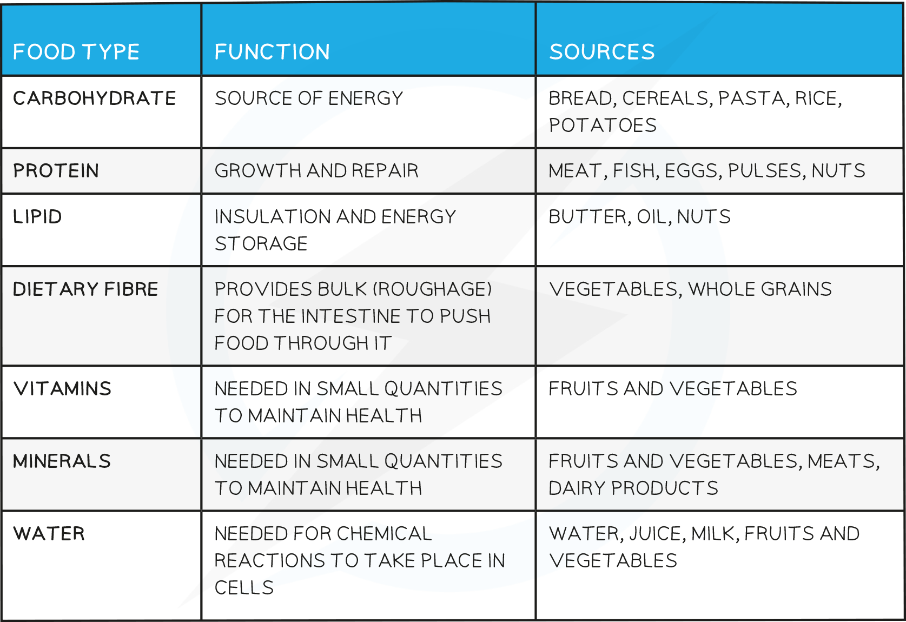
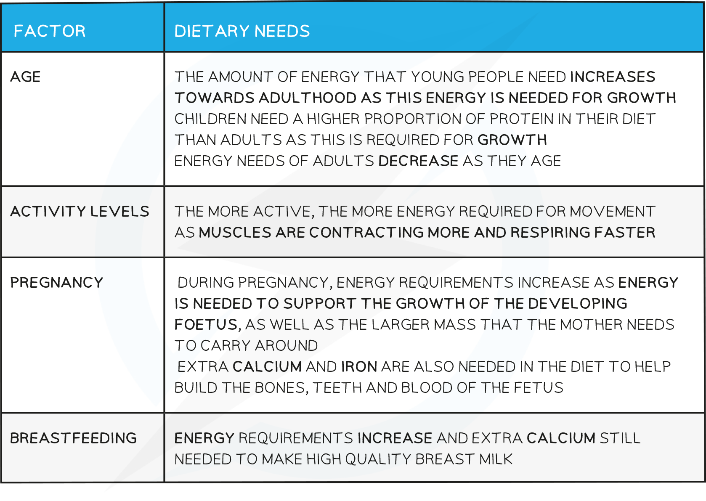

# Diet & Deficiencies

## Balanced Diet

> **Spec point** — `spcpt_bkSCYXfDSJkDVf6m` · Describe what is meant by a balanced diet
State the principal dietary sources and describe the importance of:
(a) carbohydrates
(b) fats and oils
(c) proteins
(d) vitamins, limited to C and D
(e) mineral ions, limited to calcium and iron
(f) fibre (roughage)
(g) water

## Balanced Diet

- A balanced diet consists of all of the food groups in the correct proportions
- The necessary food groups are:

  - **Carbohydrates**
  - **Proteins**
  - **Lipids**
  - **Vitamins**
  - **Minerals**
  - **Dietary Fibre**
  - **Water**

**Food Groups Table**

**Vitamin and Mineral Requirements Table**

**Varying Dietary Needs of Individuals Table**

