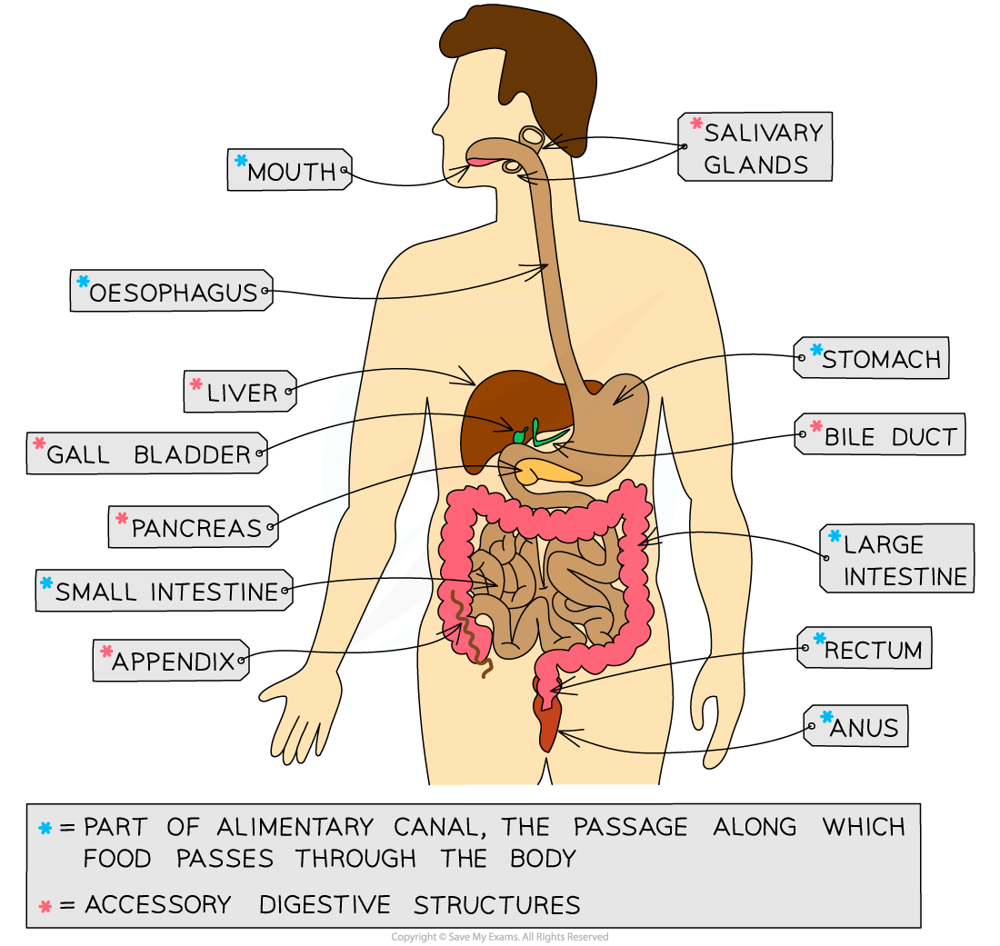

# Digestive System

## Identifying organs of the digestive system

> **Spec point** — `spcpt_FRgPRzdtG9DFHZry` · nan

## Identifying organs of the digestive system

- The digestive system is an example of an [organ system](https://www.savemyexams.com/igcse/biology/cie/23/revision-notes/2-organisation-of-the-organism/2-1-cell-structure-and-size-of-specimens/2-1-2-organisation-of-cells/#:~:text=Levels%20of%20Organisation%20in%20an%20Organism)
- Some of the digestive system organs make up the **alimentary canal**; food passes directly through these organs as it moves through the body:

  - mouth
  - oesophagus
  - stomach
  - small intestine, including the duodenum and the ileum
  - large intestine, including the colon, rectum and anus
- Some of the organs of the digestive system do not form part of the route travelled by food, but are still involved with digestion; these are the **associated organs**, or accessory organs, and include the:

  - salivary glands
  - pancreas
  - liver
  - gall bladder

*The organs of the human digestive system work together to digest food and absorb nutrients*

## Organs of the digestive system: function

> **Spec point** — `spcpt_vqDQQvPrhqdb65Rs` · nan

## Organs of the digestive system: function

- The function of the digestive system is to **digest food** and **absorb nutrients**
- The digestive system carries out its function in several stages:

  - **ingestion**: food and drink are taken into the body through the mouth
  - **mechanical digestion**: food is broken down into smaller pieces without chemical change to the food molecules
  - **chemical digestion**: large, insoluble molecules are broken down into small, soluble molecules
  - **absorption**: small food molecules and ions move through the wall of the intestine into the blood
  - **egestion**: food that has not been digested or absorbed passes out of the body as faeces
- Once nutrients have been absorbed into the blood by the digestive system they can be **assimilated** into the body; this occurs when they are taken up by the cells of the body

| **Structure** | **Function** |
|---|---|
| Mouth | Food is **ingested** here and the teeth break it down into smaller pieces during **mechanical digestion** |
| Salivary glands | Saliva is secreted into the mouth  The enzyme **amylase** in saliva begins to digest starch into maltose  Saliva lubricates the food for easy swallowing |
| Oesophagus | This tube connects the mouth to the stomach  Contractions of the walls of the oesophagus force the food downwards; this is peristalsis |
| Stomach | Churning of the muscular stomach walls continues the process of mechanical digestion  **Protease** enzymes begin protein digestion  **Hydrochloric acid** provides a suitable pH for the enzymes and also destroys any pathogens in food |
| Liver | **Bile** is produced here  Bile aids the digestion of fats, as well as neutralising stomach acid as it exits the stomach |
| Gall bladder | Bile is stored here before being released into the duodenum via the bile duct |
| Pancreas | **Amylase**, **protease** and **lipase** enzymes are produced here before being released into the duodenum |
| Small intestine: duodenum | Food enters the small intestine from the stomach here  The acidic stomach contents are neutralised by bile and become slightly alkaline  Enzymes complete **chemical digestion** here |
| Small intestine: ileum | Food and water are **absorbed** into the blood via villi in the lining of the ileum |
| Large intestine: colon | Remaining water is absorbed from food into the blood, and the solid waste left behind in the colon forms **faeces** |
| Large intestine: rectum | Faeces are stored here prior to egestion |
| Large intestine: anus | Faeces leave the body via the anus; this is **egestion** |
