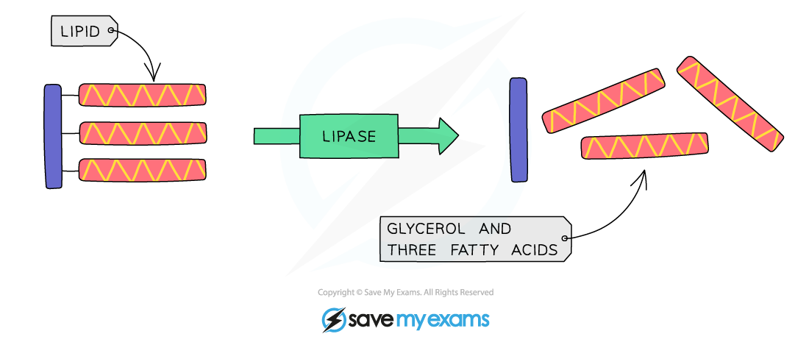

# Enzymes in Digestion

## Enzymes in Digestion: Extended

> **Spec point** — `spcpt_PYyfwbKkt3jKpZcy` · Describe the functions of enzymes as follows:
(a) amylase breaks down starch to simple reducing sugars
(b) proteases break down protein to amino acids
(c) lipase breaks down fats and oils to fatty acids and glycerol
State where, in the digestive system, amylase, protease and lipase are secreted and where they act

## Enzymes in Digestion: Extended

#### Amylases

- **Amylases** are produced in the **mouth** and the **pancreas** (secreted into the **duodenum**)
- Amylases digest **starch into smaller sugars**

***The digestion of starch***

#### Proteases

- Proteases are a group of **enzymes that break down proteins into amino acids** in the stomach and small intestine (with the enzymes in the small intestine having been produced in the pancreas)

***The digestion of proteins***

#### Lipases

- **Lipase** enzymes are produced in the **pancreas** and secreted into the **duodenum**
- They digest **lipids into fatty acids and glycerol**

***The digestion of lipids***
