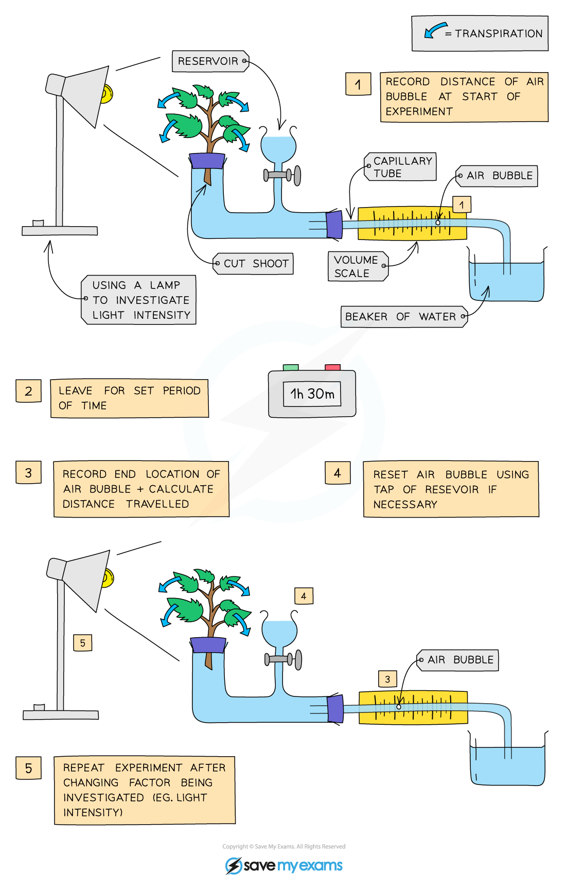

# Investigating Temperature & Wind Speed

## Investigating the Effect of Temperature & Wind Speed on Transpiration Rate: Extended

> **Spec point** — `spcpt_WyRNxMtDD3XSxDw2` · Investigate and describe the effects of variation of temperature and wind speed on transpiration
rate

## Investigating the Effect of Temperature & Wind Speed on Transpiration Rate: Extended

**Method:**

- Cut a shoot underwater to **prevent air entering the xylem** and place in tube
- Set up the apparatus as shown in the diagram and make sure it is airtight, using vaseline to seal any gaps
- Dry the leaves of the shoot (wet leaves will affect the results)
- Remove the capillary tube from the beaker of water to allow a single **air bubble** to form and place the tube back into the water
- Set up the environmental factor you are investigating
- Allow the plant to adapt to the new environment for 5 minutes
- Record the **starting location** of the air bubble
- Leave for a set period of time
- Record the **end location** of air bubble
- Change the wind speed or temperature (only one - whichever factor is being investigated)
- Reset the bubble by opening the tap below the reservoir
- Repeat the experiment
- The **further the bubble travels in the same time period, the faster transpiration is occurring** and vice versa

**An experimental setup for testing the effect of light intensity on transpiration rates. The apparatus can be modified to test the effects of temperature and wind speed.**

- Environmental factors can be investigated in the following ways:

  - **Temperature**: Temperature of room (cold room and warm room)
  
    - As temperature increases, the rate of transpiration also increases
  - **Wind speed**: Use an electric fan to mimic different wind speeds
  
    - As wind speed increases, the rate of transpiration also increases

> **Exam Hint**
> Remember when designing an investigation to ensure a fair test you must keep all factors the same other than the one you are investigating.
