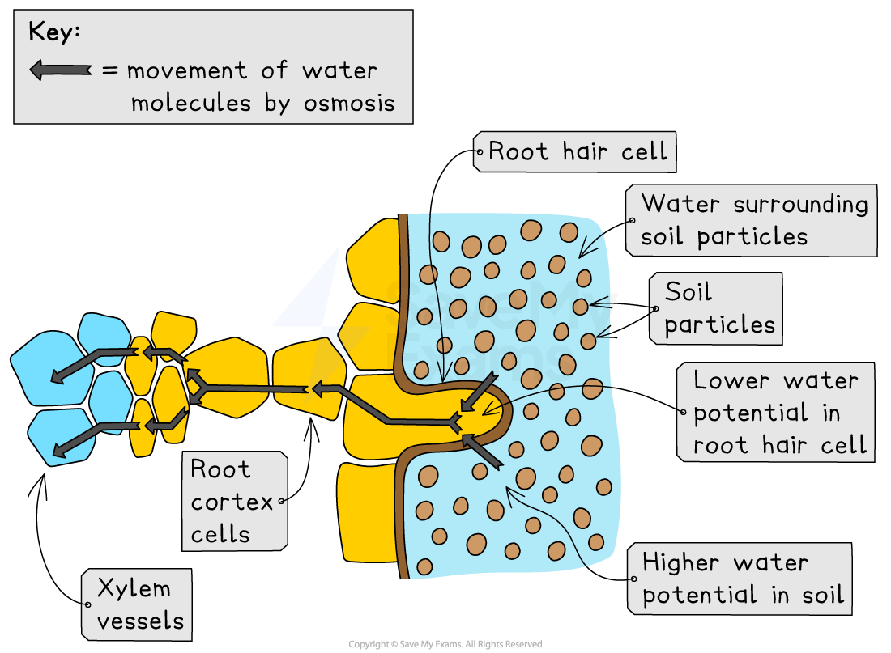

# Pathway Taken by Water

## Pathway Taken by Water

> **Spec point** — `spcpt_VpSXKmnNrSyBCGJ3` · Outline the pathway taken by water through the root, stem and leaf as: root hair cells, root cortex cells, xylem, mesophyll cells

## Pathway taken by water

- Water is taken up from the soil into root hair cells
- Water then moves across the root *cortex* and into the xylem vessels by [osmosis](https://www.savemyexams.com/igcse/biology/cie/23/revision-notes/3-movement-into-and-out-of-cells/3-1-diffusion-osmosis-and-active-transport/3-1-4-osmosis/)

***Pathway of water into and across a root***

- Water is then transported in the **xylem** to the leaves where it enters the leaf **mesophyll cells**
- So the pathway is:

**root hair cell → root cortex cells → xylem → leaf mesophyll cells**
