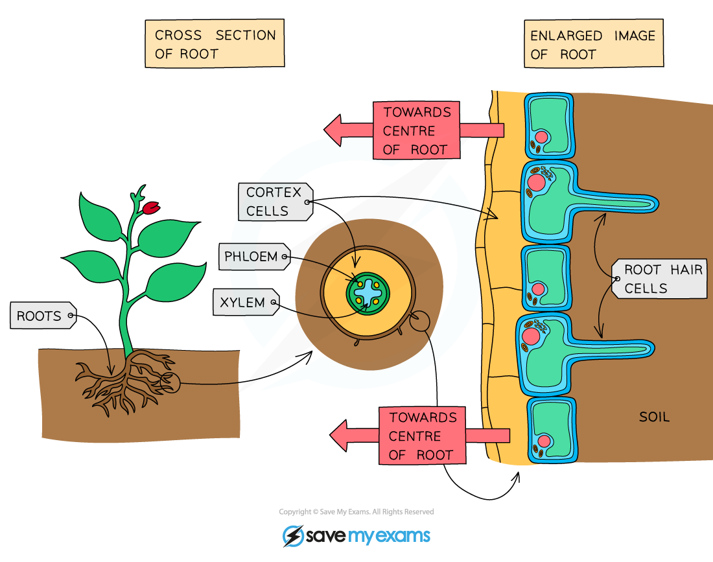

# Root Hair Cells

## Root hair cells

> **Spec point** — `spcpt_7rYkZNxvfrCvMRPr` · Identify in diagrams and images root hair cells and state their functions
State that the large surface area of root hairs increases the uptake of water and mineral ions

## Root hair cells

- Root hairs are single-celled extensions of **epidermis cells** in the root
- They grow between soil particles and absorb water and minerals from the soil
- Water enters the root hair cells by **osmosis**
- This happens because soil water has a **higher water potential than the cytoplasm** of the root hair cell

*Structure of the roots*

- The root hair increases the surface area of the cells significantly
- This large surface area is important as it **increases the rate of the absorption of water by osmosis and mineral ions by active transport**
