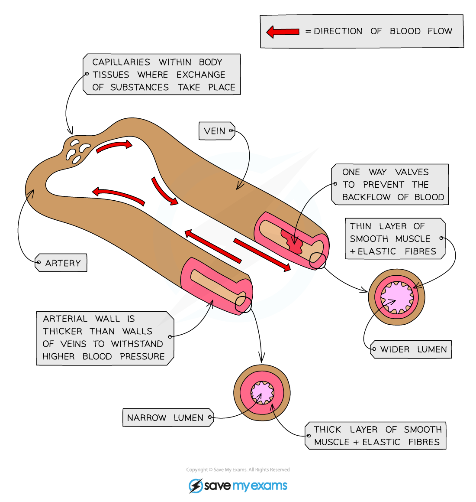

# Blood Vessels

## Arteries, veins & capillaries

> **Spec point** — `spcpt_4m3bJ8z37SqQFmwG` · nan

## Arteries, veins & capillaries

- The blood vessels are a system of closed tubes within which blood flows
- Different types of blood vessels transport blood in different directions, and to different parts of the body

### Arteries

- These blood vessels carry blood **away from the heart** at high pressure
- Arteries transport **oxygenated** blood

  - The single exception to this is the pulmonary artery
- The walls of arteries are **thick** and **muscular** and contain **elastic fibres**
- Arteries have a **narrow lumen**

### Veins

- These blood vessels carry blood** towards the heart **at low pressure
- Veins transport **deoxygenated** blood

  - The single exception to this is the pulmonary vein
- The walls of veins are **thin **in comparison to arteries
- Veins have a **wide lumen**
- **Valves** in veins prevent blood from flowing backwards

*Arteries carry blood away from the heart at high pressure, while veins carry blood towards the heart at low pressure*

### Capillaries

- These blood vessels carry blood** to the cells **of the tissues
- Capillaries transport **oxygenated** blood from the arteries to the cells, and **deoxygenated** blood from the cells to the veins
- The walls of capillaries are **one cell thick** and contain gaps to allow fluid to leak out
- Capillaries have a very **narrow lumen**

*Capillaries are tiny blood vessels that carry blood to the cells of the body*
