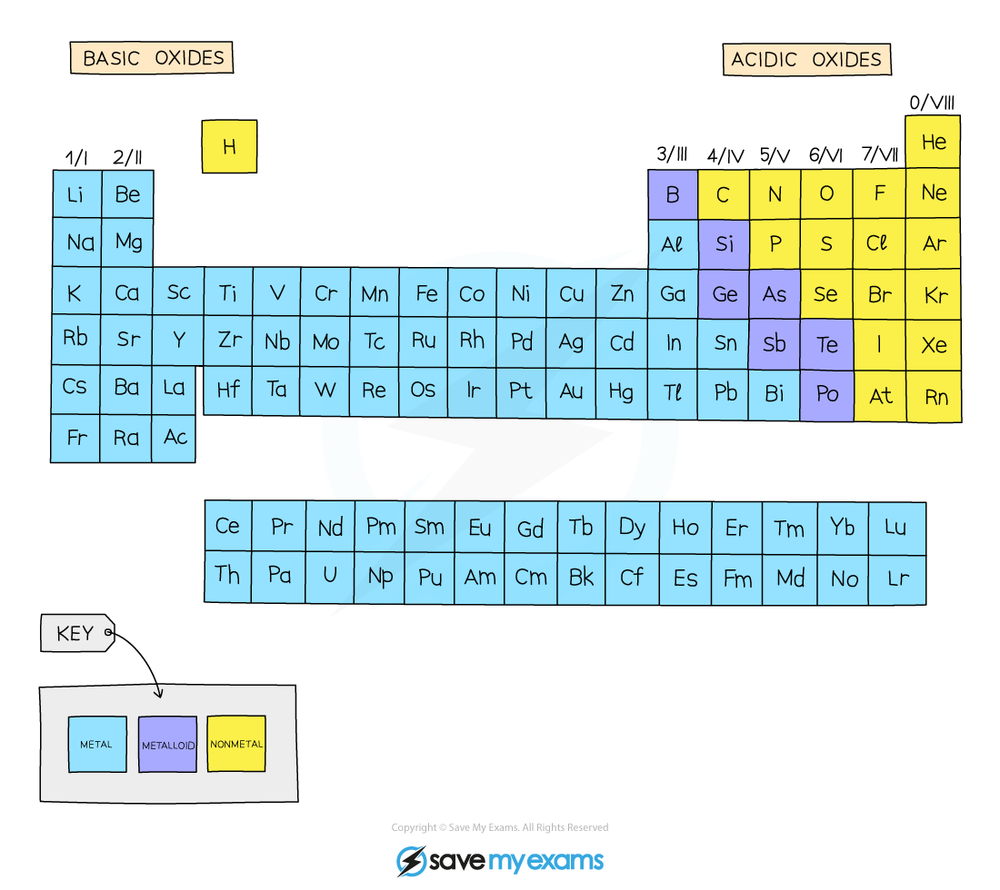

# Classifying Oxides

## Classifying oxides

> **Spec point** — `spcpt_Qkyjh9D4FkWkCVdf` · Classify oxides as acidic, including SO2 and CO2, or basic, including CuO and CaO, related to metallic and non-metallic character

## Classifying oxides as acidic or basic

### What are oxides?

- Oxides are compounds made from one or more atoms of oxygen combined with one other element
- Examples of oxides include:

  - Magnesium oxide - MgO
  - Zinc oxide - ZnO
  - Potassium oxide - K2O
  - Carbon dioxide - CO2
  - Sulfur dioxide - SO2
  - Water - H2O
- Oxides can be classified based on their acid-base characteristics

### Acidic oxides

- Acidic oxides are formed when a **non-metal** element combines with oxygen
- Common examples include:

  - CO2
  - SO2
  - NO2
  - SiO2

### Basic oxides

- Basic oxides are formed when a **metal** element combines with oxygen
- Common examples include:

  - CuO
  - CaO

#### Basic and acidic oxides

***Metals form basic oxides while non-metals form acidic oxides***
