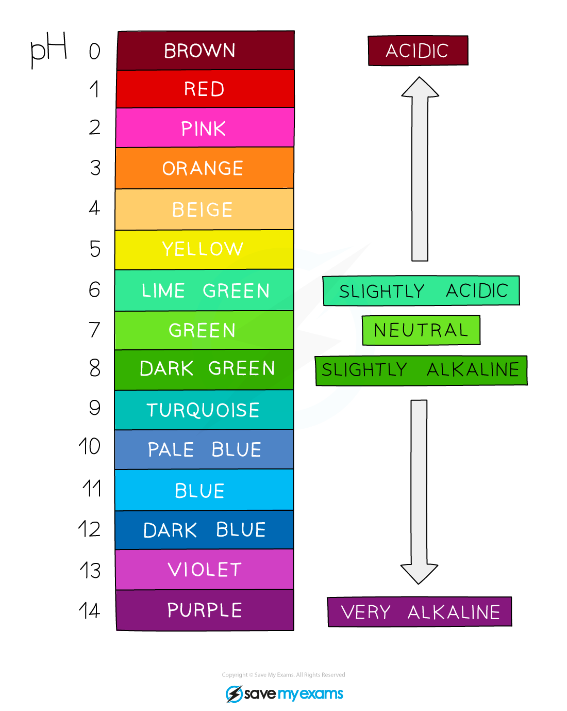

# Comparing Acids & Alkalis

## Hydrogen ion concentration & pH

> **Spec point** — `spcpt_cdYF5bghs4qYrQb2` · Describe how to compare hydrogen ion concentration, neutrality, relative acidity and relative alkalinity in terms of colour and pH using universal indicator paper

## The pH scale and universal indicator

### What is the pH scale?

- The pH scale goes from 1 – 14
- All acids have pH values of **below** 7, all alkalis have pH values of **above** 7
- The** lower** the pH then the **more acidic** the solution is:

  - pH 0-2 = strong acid
  
    - Extremely acidic substances can have values of below 1
  - pH 3-6 = weak acid
- The **higher** the pH then the **more alkaline** the solution is:

  - pH 8-11 = weak alkali
  - pH 12-14 = strong alkali
- A solution of pH 7 is described as being **neutral**

#### The pH scale

***The pH scale showing acidity, neutrality and alkalinity***

### How is universal indicator paper used?

- Universal indicator paper is used to measure the pH
- A small strip of universal indicator paper is dipped into the solution
- The colour is matched with a colour chart which indicates the pH which matches specific colours
- The colour and pH can be used to compare solutions:

  - **Neutral** solutions give a green colour (pH 7)
  - The more **acidic** the solution:
  
    - The **lower** the pH
    - The colour moves towards **red/orange/yellow**
  - The more **alkaline** the solution:
  
    - The **higher** the pH
    - The colour moves towards **blue/purple**

***The pH scale with the Universal Indicator colours which can be used to determine the pH of a solution***
