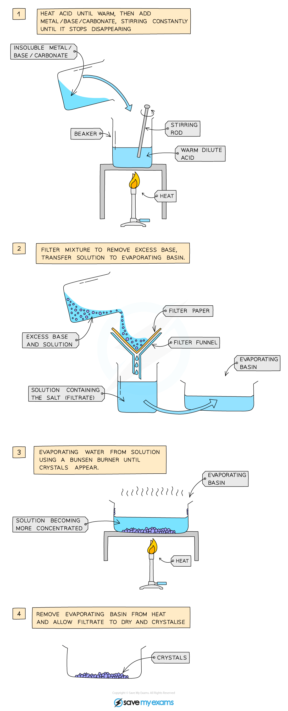
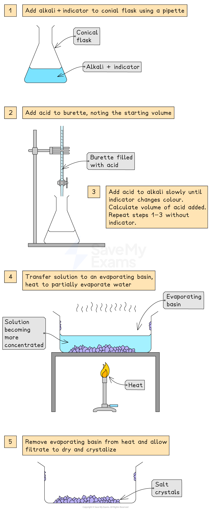

# Preparing Soluble Salts

## Preparing soluble salts

> **Spec point** — `spcpt_M582ppKPXY8tBNrJ` · Describe the preparation, separation and purification of soluble salts by reaction of an acid with: 
an alkali by  titration 
excess metal 
excess insoluble base 
excess insoluble carbonate

## Preparing soluble salts

### How to name a salt

- The name of salt has two parts:

  1. The first part comes from the **metal**, **metal** oxide or **metal** carbonate used in the reaction
  2. The second part comes from the **acid**
- The name of the salt can be determined by looking at the reactants

  - For example, hydrochloric acid always produces salts that end in chloride and contain the **chloride** ion, Cl-
- Other examples:

  - **Sodium **hydroxide reacts with hydro**chloric** acid to produce sodium chloride
  - **Zinc **oxide reacts with **sulf**uric acid to produce **zinc** **sulfate**

### What is a salt?

- A salt is a compound that is formed when the **hydrogen atom** in an acid is replaced by a **metal** or **ammonium ion**

  - For example, replacing H in HCl with potassium gives potassium chloride, KCl
- Salts have many uses including:

  - Fertilisers
  - Batteries
  - Cleaning products
  - Healthcare products
  - Fungicides
- The method used depends on:

  - The **solubility** of the salt being prepared
  - Whether the base is **insoluble** or **soluble (alkali)**

### Preparing soluble salts

- There are two main methods of preparing a soluble salt:
- **Method A: Using excess solid reactant**

  - This includes three reactions:
  
    1. Using excess metal
    2. Using excess insoluble base
    3. Using excess insoluble carbonate
- **Method B: Using an alkali (by titration)**

  - This is for soluble bases such as sodium hydroxide
- The method used depends on:

  - Whether the base is **insoluble** or **soluble (alkali)**
  - Whether a **metal** is used

### Method A: Using excess solid reactant

This method is used when the reactant is a **solid in excess**. Any unreacted solid is removed by filtration, then the salt is crystallised.

#### Method A1: Using excess metal

- This is for metals that react with dilute acids

1. Add dilute acid to a beaker
2. Add the metal in small pieces while stirring until no more reacts

  - This means that the metal is in excess
3. Filter the mixture to remove the excess metal
4. Transfer the filtrate (salt solution) to an evaporating basin
5. Heat the evaporating basin gently until the solution is concentrated

  - Check the solution is saturated by dipping a cold, glass rod into the solution and seeing if crystals form on the end
6. Leave the basin in a warm place to crystallize
7. If necessary, decant any excess liquid
8. Dry the crystals with filter paper

Example reaction - preparing magnesium sulfate crystals:

**magnesium + sulfuric acid → magnesium sulfate + hydrogen**

**Mg (s) + H****2****SO****4**** (aq) → MgSO****4**** (aq) + H****2**** (g)**

#### Method A2: Using excess insoluble base

- This is for insoluble bases such as metal oxides

1. Warm dilute acid gently in a beaker
2. Add the insoluble base slowly while stirring until no more reacts

  - This means that the insoluble base is in excess
3. Filter the mixture to remove the excess insoluble base
4. Transfer the filtrate (salt solution) to an evaporating basin
5. Heat the evaporating basin gently until the solution is concentrated

  - Check the solution is saturated by dipping a cold, glass rod into the solution and seeing if crystals form on the end
6. Leave the basin in a warm place to crystallize
7. If necessary, decant any excess liquid
8. Dry the crystals with filter paper

*Diagram showing the preparation of soluble salts *

- Example reaction - preparing copper(II) sulfate:

**copper(II) oxide + sulfuric acid → copper(II) sulfate + water**

**CuO (s) + H****2****SO****4**** (aq) → CuSO****4**** (aq) + H****2****O (l)**

#### Method A3: Using excess insoluble carbonate

- This is for metal carbonates that do not dissolve in water
- The method is exactly the same as using excess insoluble base:

  - Warm dilute acid gently in a beaker
  - Add the insoluble carbonate slowly while stirring until no more reacts (carbonate in excess)
  - Filter to remove the excess insoluble carbonate
  - Transfer the filtrate (salt solution) to an evaporating basin
  - Heat the evaporating basin gently until the solution is concentrated
  - Leave to crystallize, decant any excess liquid, and dry the crystals
- Example reaction - preparing calcium chloride:

**calcium carbonate + hydrochloric acid → calcium chloride + carbon dioxide + water**

**CaCO****3**** (s) + 2HCl (aq) → CaCl****2**** (aq) + CO****2**** (g) + H2O (l)**

#### Method B: Using an alkali (by titration)

- This is for soluble bases such as sodium hydroxide

1. Use a pipette to place alkali in a conical flask
2. Add a few drops of indicator (e.g. phenolphthalein)
3. Fill a burette with the acid and record the starting volume
4. Add the acid slowly while swirling until the indicator changes colour (end point)

  - Record the final volume
5. Repeat the titration without indicator, using the same measured volume of acid
6. Heat the neutral solution in an evaporating basin until concentrated

  - Check the solution is saturated by dipping a cold, glass rod into the solution and seeing if crystals form on the end
7. Leave the basin in a warm place to crystallize
8. If necessary, decant any excess liquid
9. Dry the crystals with filter paper

*Diagram showing the apparatus needed to prepare a salt by titration*

- Example reaction - preparing sodium chloride crystals:

**sodium hydroxide + hydrochloric acid → sodium chloride + water**

**NaOH (aq) + HCl (aq) → NaCl (aq) + H****2****O (l)**

> **Exam Hint**
> Use **Method B (titration)** if the base is soluble (alkali)
> 
> Use **Method A (excess solid)** if adding a solid in excess, then filtering and crystallising:
> 
> - **A1** for excess metal
> - **A2** for excess insoluble base
> - **A3** for excess insoluble carbonate
