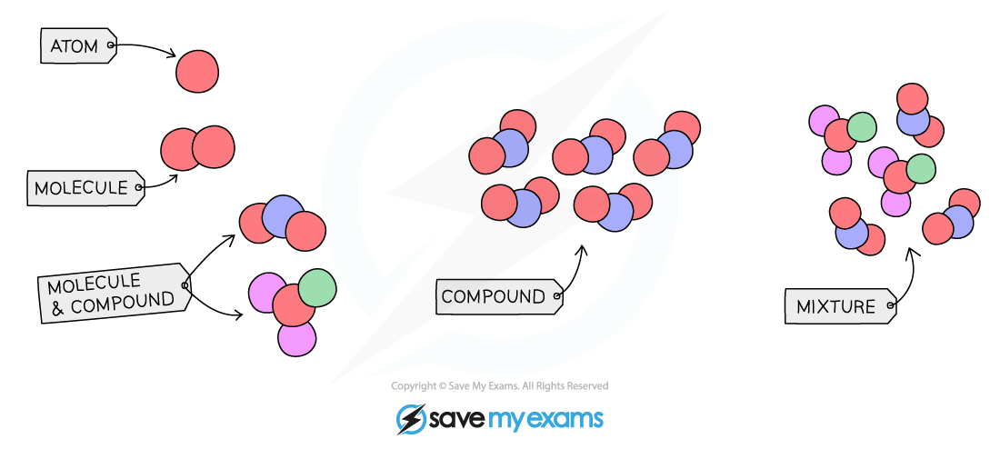

# Elements, Compounds & Mixtures

## Elements, compounds & mixtures

> **Spec point** — `spcpt_SqrwK3SsDrZ6PRBn` · nan

## Elements, compounds & mixtures

- All substances can be classified into one of these three types

  - Elements
  - Compounds
  - Mixtures

### What is an element?

- A substance made of atoms that all contain the **same number of protons **and cannot be split into anything simpler **by chemical means**
- There are around 118 elements in the Periodic Table

### What is a compound?

- A pure substance made up of two or more elements **chemically combined**
- There is an **unlimited** number of compounds
- Compounds cannot be separated into their elements by physical means
- E.g. copper(II) sulfate (CuSO4), calcium carbonate (CaCO3), carbon dioxide (CO2)

### What is a mixture?

- A combination of two or more substances (elements and/or compounds) that are **not **chemically combined
- Mixtures can be separated by **physical methods** such as filtration or evaporation
- E.g. sand and water, oil and water, sulfur powder and iron filings

***Particle diagram showing elements, compounds and mixtures***** **
