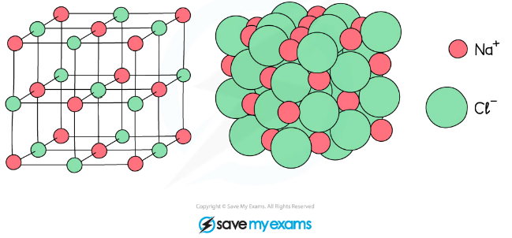
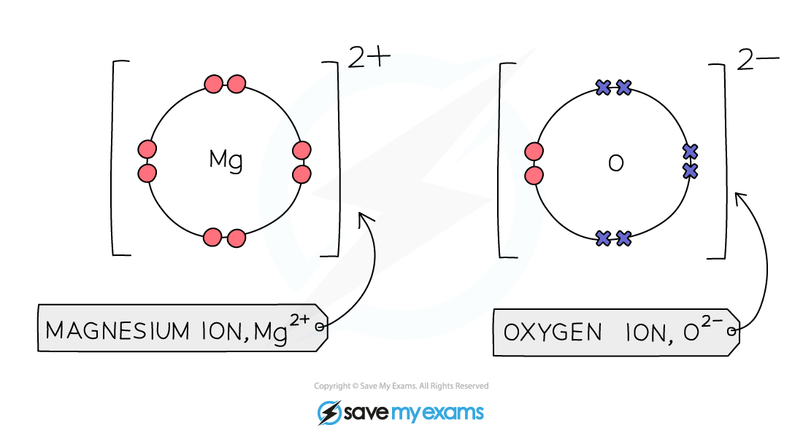

# Ionic Bonds & Lattice Structure

## The lattice structure of ionic compounds

> **Spec point** — `spcpt_XfJMyKV6CYwKKW85` · Describe the giant lattice structure of ionic compounds as a regular arrangement of alternating positive and negative ions

## The lattice structure of ionic compounds

### Extended Tier Only

### Lattice structure

- Ionic compounds have a **giant lattice** structure
- Lattice structure refers to the arrangement of the atoms of a substance in 3D space
- In lattice structures, the atoms are arranged in an **ordered** and **repeating **fashion
- The lattices formed by ionic compounds consist of a **regular** **arrangement** of **alternating** positive and negative ions

***The lattice structure of NaCl***

## Ionic bonds between metallic & non-metallic elements

> **Spec point** — `spcpt_zprbZ3WzDvmTdWdm` · Describe the formation of ionic bonds between ions of metallic and non-metallic elements, including the use of dot-and-cross diagrams

## Ionic bonds between metallic & non-metallic elements

### Extended Tier Only

### Ionic compounds

- Ionic compounds are formed when metal atoms and non-metal atoms react
- The ionic compound has **no **overall charge

### Example: magnesium Oxide, MgO

- Magnesium is a Group II metal so will lose two outer electrons to another atom to have a full outer shell of electrons
- A positive ion with the charge 2+ is formed
- Oxygen is a Group VI non-metal so will need to gain two electrons to have a full outer shell of electrons
- Two electrons will be transferred from the outer shell of the magnesium atom to the outer shell of the oxygen atom
- Oxygen atom will gain two electrons to form a negative ion with charge 2-
- Magnesium oxide has no overall charge

  - ** **MgO

***Diagram showing the dot-and-cross diagram of magnesium oxide***

> **Exam Hint**
> When drawing dot and cross diagrams, you only need to show the outer shell of electrons. Remember to draw square brackets and include a charge for each ion. Make sure the overall charge is 0; you may need to include more than one positive or negative ion to ensure the positive and negative charges cancel each other out.
