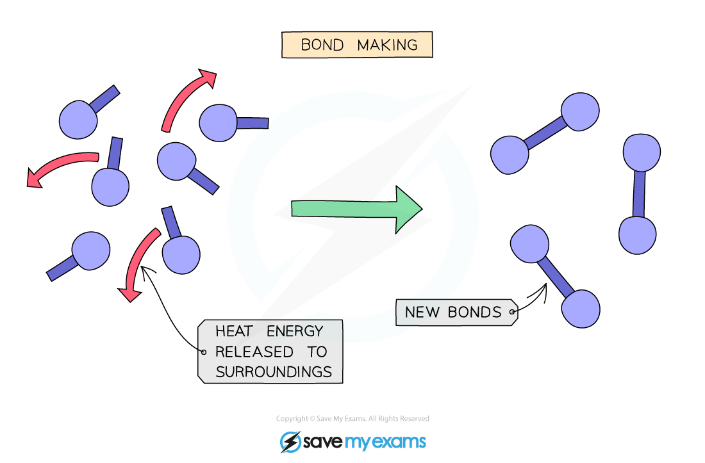
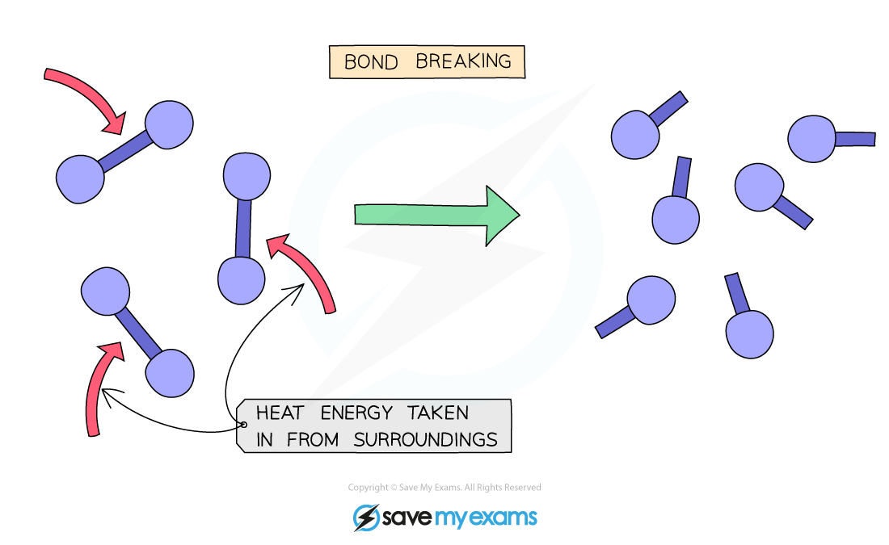

# Bond Breaking & Bond Forming

## Bond breaking & bond forming

> **Spec point** — `spcpt_BCfNtpjrcTvFZ2ZZ` · State that bond breaking is an endothermic process and bond making is an exothermic process

## Bond breaking & bond forming

### Extended Tier Only

- Whether a reaction is endothermic or exothermic depends on the difference between the energy needed to **break** existing bonds and the energy released when the new bonds are **formed**
- **Bond breaking** is always an **endothermic** process as energy needs to be taken in from the surroundings to break the chemical bonds
- **Bond making** is always an **exothermic** process as energy is transferred to the surroundings as the new bond is formed

### Exothermic reactions

- If more energy is released than is absorbed, then the reaction is **exothermic**
- More energy is released when new bonds are formed than energy required to break the bonds in the reactants
- The change in energy is negative since the products have less energy than the reactants
- Therefore, an exothermic reaction has a **negative** Δ*H* value

***Making new chemical bonds releases energy which radiates outwards from the reaction to the surroundings in the form of heat***

### Endothermic reactions

- If more energy is absorbed to break bonds than is released to form new bonds, this reaction is** endothermic overall**
- The change in energy is positive since the products have more energy than the reactants
- The symbol Δ*H* is used to show the change in heat energy

  - *H* is the symbol for enthaply, which is a measure of the total **heat** **of reaction** of a chemical reaction
- Therefore, an endothermic reaction has a **positive** Δ*H* value

***Breaking chemical bonds requires energy which is taken in from the surroundings in the form of heat***
