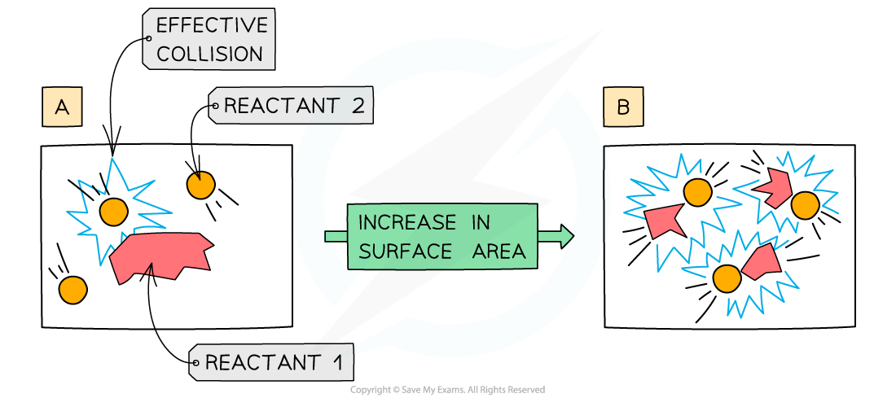
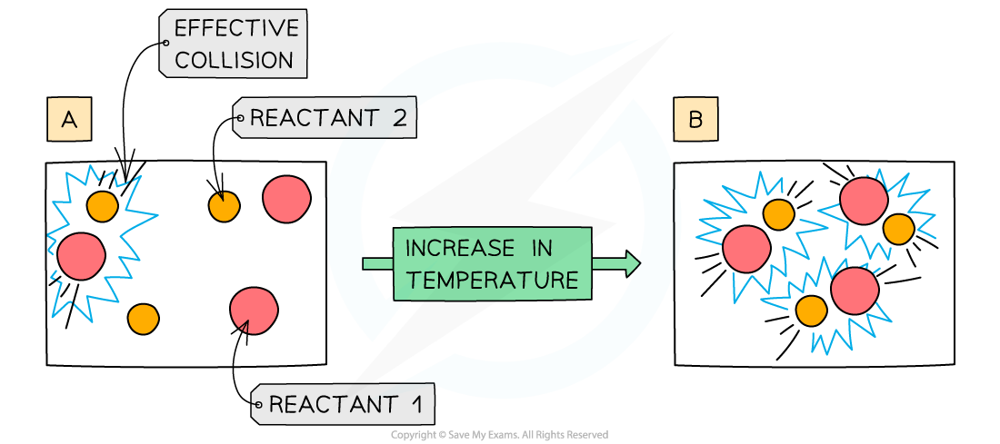
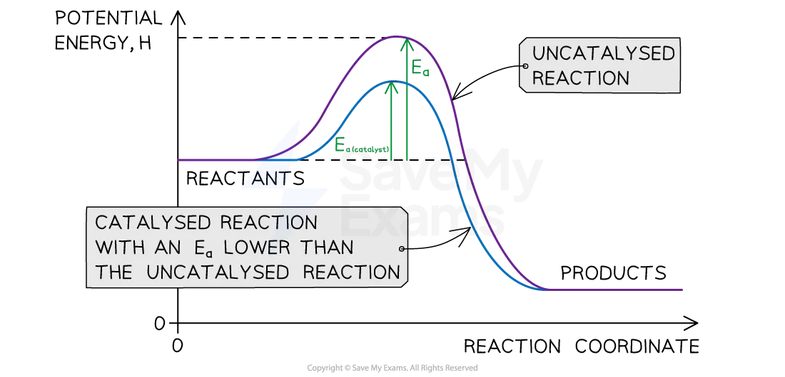

# Explaining Rates Using Collision Theory

## Explaining rates using collision theory

> **Spec point** — `spcpt_tvQYBfT9qnbrKZph` · Describe and explain the effect on the rate of reaction of: 
changing the concentration of solutions 
changing the pressure of gases 
changing the surface area of solids 
changing the  temperature 
adding or removing a catalyst, including enzymes using collision theory
State that a catalyst decreases the activation energy, Ea, of a reaction

## Explaining rates using collision theory

**Extended tier only**

- Collision theory can explain why concentration, pressure, surface area, temperature and catalysts affect the rate of a chemical reaction

### How increasing concentration affects rate

- Increasing the concentration of a solution increases the rate of reaction
- Increasing the concentration means that there are more reactant particles in a given volume

  - This causes more collisions per second
  - Leading to more frequent and successful collisions per second
  - Therefore, the rate of reaction increases
- If you double the number of particles, you will double the number of collisions per second

  - The number of collisions is **proportional** to the number of particles present

#### Diagram showing the effect of increasing concentration

***A higher concentration of particles in (b) means that there are more particles present in the same volume than (a) so the number of collisions and successful collisions between particles increases causing an increased rate of reaction***

> **Exam Hint**
> When answering questions on the effect of concentration on the rate of reaction, you should mention that there are more particles** per unit volume** (usually cm3) and this causes an increase in the rate of collisions.

### How increasing the surface area affects rate

- Increasing the surface area increases the rate of reaction
- Increasing the surface area means that a greater **surface area** of **particles** will be exposed to the other reactant

  - This causes more collisions per second
  - Leading to more frequent and successful collisions per second
  - Therefore, the rate of reaction increases
- If you double the surface area, you will double the number of collisions per second

#### Diagram showing the effect of increasing surface area

***An increase in surface area means more collisions per second***

### How increasing temperature affects rate

- Increasing the temperature increases the rate of reaction
- Increasing the temperature means that the particles have more kinetic energy

  - This causes more collisions per second
  - Leading to more frequent and successful collisions per second
  - Therefore, the rate of reaction increases
- The effect of temperature on collisions is not so straightforward as concentration or surface area; a small increase in temperature causes a large increase in rate
- For aqueous and gaseous systems, a rough rule of thumb is that for every 10 oC increase in temperature, the rate of reaction approximately doubles

#### Diagram showing the effect of increasing temperature

***An increase in temperature causes an increase in the kinetic energy of the particles. The number of successful collisions increases ***

### How a catalyst affects rate

- Catalysts are substances which **speed up **the **rate** of a reaction without themselves being **altered** or **consumed** in the reaction
- Different processes require different types of catalysts but they all work on the same principle
- A catalyst provides a **different reaction pathway **that has a **lower activation energy**

  - This means a higher proportion of the reactant particles have energy greater than the activation energy and will result in more successful collisions per second

***A catalyst lowers the activation energy of a reaction by providing an alternative reaction pathway***

- An important industrial example is iron, which is used to catalyse the Haber Process for the production of ammonia

  - Iron **beads** are used to increase the **surface** **area** available for catalysis
- Enzymes are **biological **catalysts, they work best at specific temperature and pH ranges
- Normally only **small** **amounts** of catalysts are needed to have an effect on a reaction

> **Exam Hint**
> - Temperature is the only factor that **directly **affects the energy of collisions because the increased thermal energy is converted to increased kinetic energy in the particles
> 
>   - Concentration and surface area only affect the number of collisions
> - Temperature affects reaction rate by increasing the number of collisions and increasing the energy of the collisions
> 
>   - Of these two, the increase in energy is the more important one.
