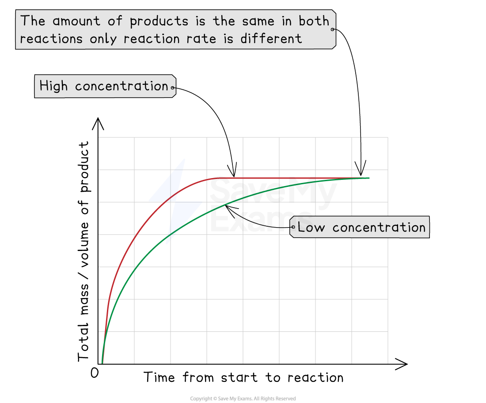
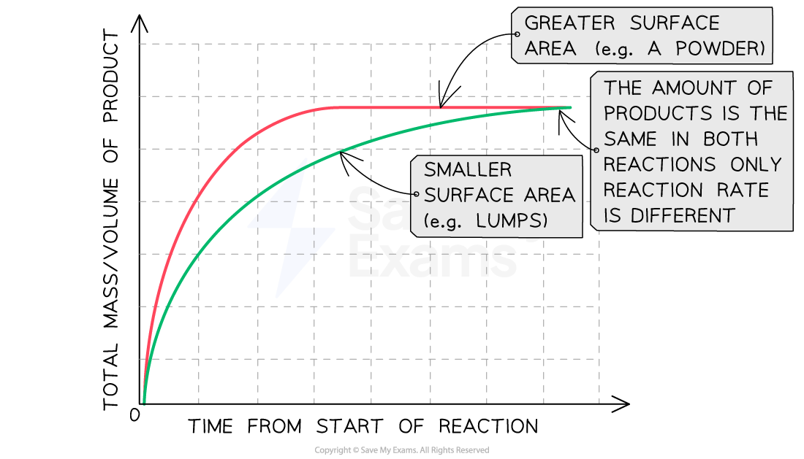
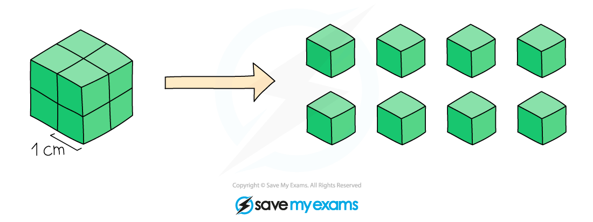
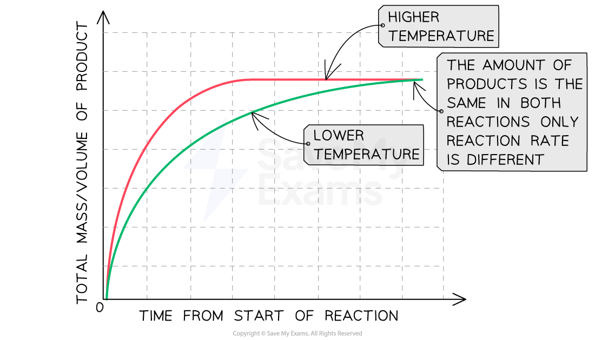
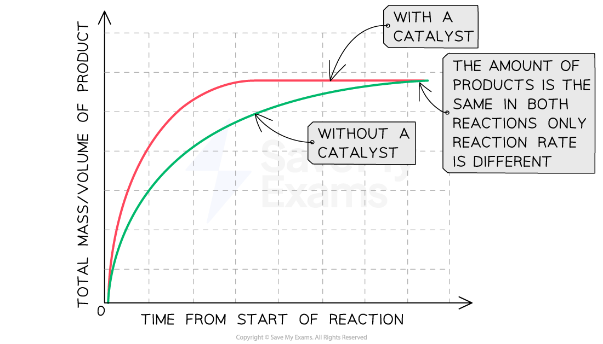

# Rates of Reaction Factors

## Rates of reaction factors

> **Spec point** — `spcpt_HSj5KzVg23wWkKwh` · Describe the effect on the rate of reaction of: 
changing the concentration of solutions 
changing the pressure of gases 
changing the surface area of solids 
changing the temperature 
adding or removing a catalyst, including enzymes
State that a catalyst increases the rate of a reaction and is unchanged at the end of a reaction

## Rates of reaction factors

- Factors that can affect the rate of a reaction are:

  - The **concentration **of the reactants in solution
  - **Surface area **of solid reactants
  - The **temperature **of the reaction
  - The presence of a **catalyst**
- Changes in these factors directly influence the rate of a reaction
- It is of **economic interest** to have a higher rate of reaction as this implies a higher rate of production and hence a more efficient and sustainable process

### The effect of increased concentration

#### Graph showing the effect of concentration on rate of reaction

***Increasing the concentration of a solution increases the rate of reaction***

#### Explanation:

- Compared to a reaction with a reactant at a low concentration, the line graph for the same reaction at a higher concentration:

  - Has a steeper gradient at the start
  - Becomes horizontal sooner
  - Forms the same amount of product
- This shows that **increasing the concentration increases the rate of reaction **

### The effect of increasing surface area

#### Graph showing the effect of surface area on rate of reaction

***Increasing the surface area increases the rate of reaction***

#### Explanation:

- Compared to a reaction with lumps of reactant, the line graph for the same reaction with powdered reactant:

  - Has a steeper gradient at the start
  - Becomes horizontal sooner
  - Forms the same amount of product
- This shows that **increasing the surface area increases the rate of reaction **

  - Increasing surface area can sometimes be described as decreasing solid particle size

#### Surface area and particle size

***Surface area increases as particle size decreases. A 2 cm******3 ******cube has a surface area of 24 cm******2 ******and the same cube cut up into 8 cubes has a surface area of 48 cm******2***

### The effect of increasing temperature

#### Graph showing the effect of temperature on rate of reaction

***Increasing the temperature increases the rate of reaction***

#### Explanation:

- Compared to a reaction at a low temperature, the line graph for the same reaction at a higher temperature:

  - Has a steeper gradient at the start
  - Becomes horizontal sooner
  - Forms the same amount of product

- This shows that **increasing the temperature increases the rate of reaction **

### The effect of using a catalyst

- Catalysts are substances which **speed up **the **rate** of a reaction without themselves being **altered** or **consumed** in the reaction
- The mass of a catalyst at the beginning and end of a reaction is the **same** and they do not form part of the equation

#### Graph showing the effect of using a catalyst on rate of reaction

***Graph showing the effect of using a catalyst on the rate of reaction***

#### Explanation:

- Compared to a reaction without a catalyst, the graph line for the same reaction but with a catalyst has a steeper gradient at the start and becomes horizontal sooner
- **This shows that with a catalyst, the rate of reaction will increase**
