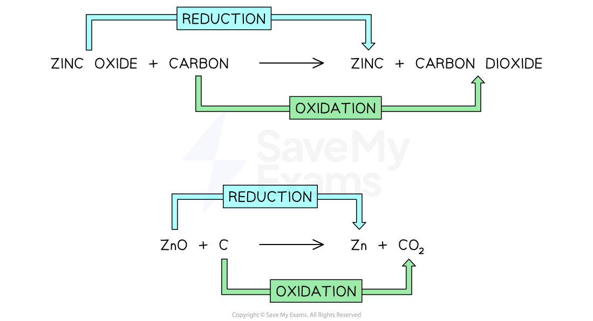

# Oxidation & Reduction

## Oxidation & reduction

> **Spec point** — `spcpt_tmrhJ5z9CqkXNRSn`

## Oxidation & reduction

### Roman numerals and oxidation numbers

- Transition elements can bond in different ways by forming ions with different charges
- When naming, the charge on the ion is shown by using a Roman numeral after the element's name
- For example, iron can form different ions

  - Iron ions with a 2+ charge, Fe2+, are called **iron(II)** ions
  - Iron ions with a 3+ charge, Fe3+, are called **iron(III)** ions
- The Roman numeral is the **oxidation number** of the element
- For example, iron reacts with oxygen to form iron oxide

  - But the name and formula of the product depend on the oxidation state of the iron ions
  - Iron(II) ions
  
    - The iron oxide product contains iron(II) ions, Fe2+
    - The name of this product is iron(II) oxide
    - The formula of this product is FeO
  - Iron(III) ions
  
    - The iron oxide product contains iron(III) ions, Fe3+
    - The name of this product is iron(III) oxide
    - The formula of this product is Fe2O3

> **Worked Example**
> 1. State the oxidation number of the transition metal ion in silver(I) chloride, AgCl.
> 2. Name, including Roman numeral, the compound with the formula CoCl2.
> 
> **Answers:**
> 
> 1. The oxidation number of the transition metal ion in silver(I) chloride, AgCl, is 1
> 
>   - **Remember: **The Roman numeral gives the oxidation number of the element before
> 2. The name, including Roman numeral, of the chemical with the formula CoCl2 is cobalt(II) chloride
> 
>   - CoCl2 contains two chloride ions, each with a 1- charge
>   - So, the cobalt ion has a 2+ charge
>   - This means the compound contains cobalt(II) ions, Co2+
>   - Therefore, it is called cobalt(II) chloride

### What is a redox reaction?

- A **redox **reaction is where oxidation and reduction take place together at the same time in the same reaction
- In terms of oxygen:

  - **Oxidation **is where **oxygen **is **added **to an element or a compound
  - **Reduction **is where **oxygen **is **removed **from an element or compound
- The reaction between zinc oxide and carbon is an example of a redox reaction

  - Zinc oxide is reduced because it has** lost** oxygen
  - Carbon is oxidised because it has **gained** oxygen

***Both reduction and oxidation has occurred in this reaction so it is classed as a redox reaction***

> **Worked Example**
> Explain which chemicals that are reduced and oxidised in the reaction between iron(III) oxide and carbon.
> 
> **iron(III) oxide + carbon monoxide → iron + carbon dioxide**
> 
> **Fe****2****O****3**** + 3CO → 2Fe + 3CO****2**** **
> 
> **Answer:**
> 
> - Iron(III) oxide loses oxygen, so it is reduced
> - Carbon monoxide gains oxygen, so it is oxidised
> 
> 

> **Exam Hint**
> You may see the term oxidation state used instead of oxidation number.
> 
> Although there is a subtle difference between the two terms (this is beyond the scope of this course), they are often used interchangeably.
> 
> Usually oxidation number is used to refer to the Roman numerals found within the name.
