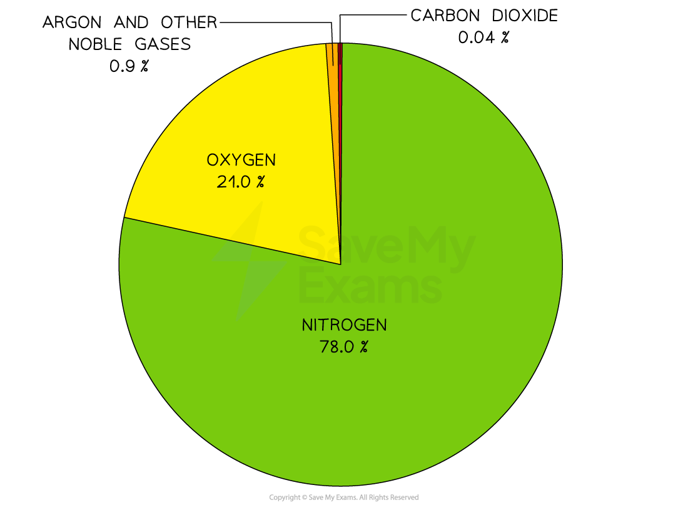
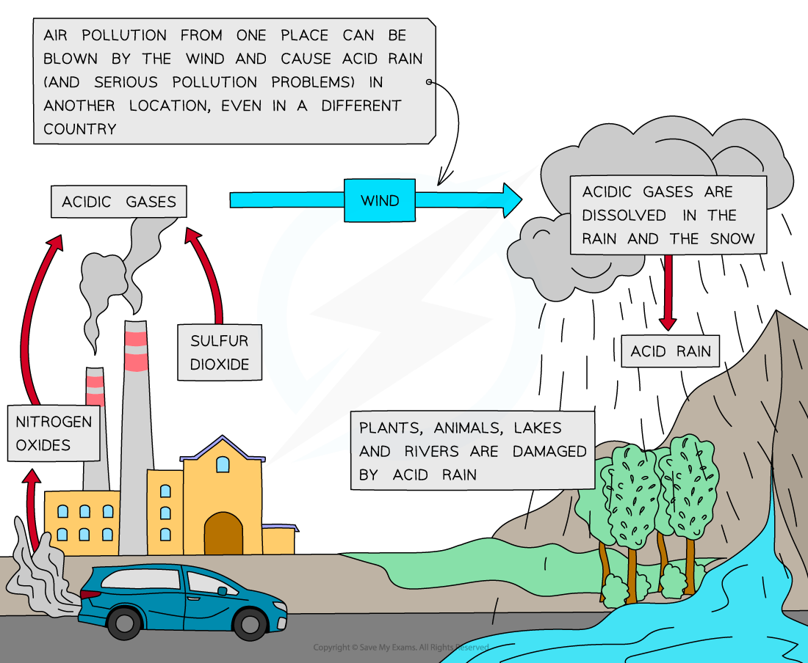

# Air

## The composition of air

> **Spec point** — `spcpt_Rpnfvw3dVbrxpdPk` · State the composition of clean, dry air as approximately 78% nitrogen, N2 , 21% oxygen, O2 and the remainder as a  mixture of noble gases and carbon dioxide, CO2

## The composition of air

- The composition of gases in the atmosphere has not changed much in 200 million years
- Clean, dry air contains approximately:

  - 78% nitrogen
  - 21% oxygen
  - Small amounts of carbon dioxide and noble gases

#### Pie chart of the current atmosphere

***The two main gases in the air are nitrogen and oxygen***

## Air pollution

> **Spec point** — `spcpt_k6K2JVw3VkPvS9p7` · State the source of each of these air pollutants, limited to: 
carbon dioxide from the complete combustion of  carbon-containing fuels 
carbon monoxide and particulates from the incomplete combustion of carbon-containing fuels 
methane from the decomposition of vegetation and waste gases from digestion in animals 
oxides of  nitrogen from car engines 
sulfur dioxide from the combustion of fossil fuels which contain sulfur compounds
3. State the adverse effect of these air pollutants, limited to: 
carbon dioxide: higher levels of carbon dioxide leading to increased global warming, which leads to climate change 
carbon monoxide: toxic gas 
particulates: increased risk of respiratory problems and cancer 
methane: higher levels of methane leading to increased global warming, which leads to climate change 
oxides of nitrogen: acid rain, photochemical smog and respiratory problems 
sulfur dioxide: acid rain

## Air pollution

- In addition to the gases present naturally in our atmosphere, other gases are present due to human activities and are classed as air pollutants

### Carbon dioxide

- **Sources:**

  - Complete combustion of carbon-containing fuels such as fossil fuels
  - For example, the complete combustion of methane:

**CH****4**** + 2O****2**** → CO****2**** + 2H****2****O**

- **Adverse effects: **

  - Increases global warming, which leads to climate change

### Carbon monoxide

- **Sources**:

  - Incomplete combustion of carbon-containing fuels such as fossil fuels
  - For example, the incomplete combustion of gasoline / octane:

**C****8****H****18**** + 10O****2**** → 5CO + 3CO****2**** + 9H****2****O**

- **Adverse effects**:

  - Toxic / poisonous
  - It combines with haemoglobin in the blood and prevents it from carrying oxygen

### Particulates

- **Sources:**

  - Incomplete combustion of carbon-containing fuels such as fossil fuels can also produce particulates of carbon (soot)
  - For example, the incomplete combustion of methane can produce CO and C:

**2CH****4 ****+ 3O****2****→ 2CO + 4H****2****O**

**CH****4 ****+ O****2****→ C + 2H****2****O**

- **Adverse effects**:

  - Respiratory problems
  - Cancer

### Methane

- **Sources:**

  - Waste gases from digestive processes of animals
  - Decomposition of vegetation
  - Bacterial action in swamps, rice paddy fields and landfill sites
- **Adverse effects**:

  - Increases global warming, which leads to climate change

### Oxides of nitrogen

- **Sources**:

  - Reaction of nitrogen with oxygen in the presence of high temperatures, e.g. in car engines, high-temperature furnaces and when lightning occurs
  - It is also a product of bacterial action in the soil
- **Adverse effects**:

  - Dissolves in rain to form **acid rain **which causes corrosion to metal structures, buildings and statues made of carbonate rocks, damage to aquatic organisms
  - Pollutes crops and water supplies
  - Irritates lungs, throats and eyes and causes **respiratory** problems

### Sulfur dioxide

- **Sources**:

  - Combustion of fossil fuels containing sulfur compounds:

**S + O****2**** → SO****2**

- Power stations are a major source of sulfur dioxide
- **Adverse effects**:

  - Dissolves in rain to form **acid rain** with similar effects as the acid rain caused by oxides of nitrogen

***How acid rain is produced***

> **Exam Hint**
> Complete and incomplete combustion of hydrocarbons produce different products.
> 
> - Complete combustion occurs in **excess** oxygen and produces **CO****2** and **H****2****O**.
> - Incomplete combustion occurs in **oxygen-deficient** conditions and produces **CO**, **H****2****O** and sometimes particulates of **carbon **(soot).
