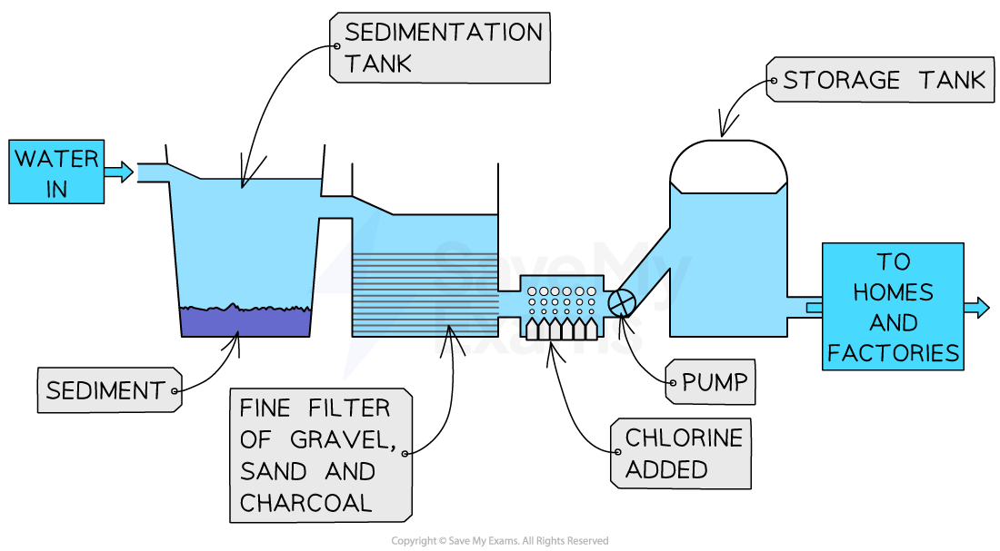

# Water Treatment

## Water treatment

> **Spec point** — `spcpt_xpst8cvWjRVN4p6X` · Describe the treatment of the domestic water supply in terms of: 
sedimentation and filtration to remove solids 
use of carbon to remove tastes and odours 
chlorination to kill microbes (pathogens)

## Water treatment

- Untreated water contains **soluble** and **insoluble** impurities

  - Insoluble impurities include soil, pieces of plants and other organic matter
  - Soluble impurities include dissolved calcium, metallic compounds and inorganic pollutants

1. The first step of water treatment is **sedimentation and filtration **to remove solids

  - Water is pumped into sedimentation tanks and allowed to stand for a few hours
  - Mud, sand and other particles will fall to the bottom of the tank due to gravity and form a layer of sediment
  - The water is then **filtered **through sand and gravel to remove smaller particles
2. The second step is **filtration through carbon **(charcoal)

  - This removes unpleasant tastes and odours
3. The final step is **chlorination**

  - Bacteria and other microorganisms are too small to be trapped by the filters
  - So, chlorine is carefully added to the water supply to kill microbes
  - Cholera and typhoid are examples of bacterial diseases which can arise from the consumption of untreated water

#### Diagram showing the stages in the treatment of water

***The stages of treating water are sedimentation, filtration with carbon and chlorination***

> **Exam Hint**
> Exam questions on water treatment often focus on the purpose of each stage of the process.
