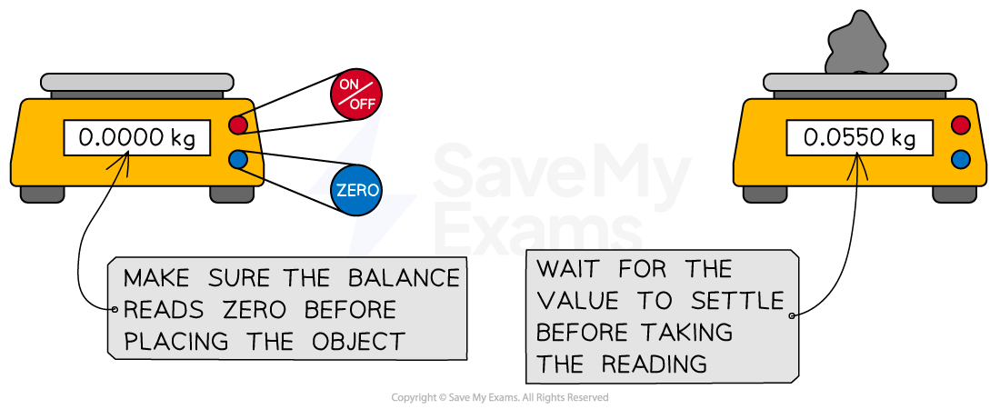
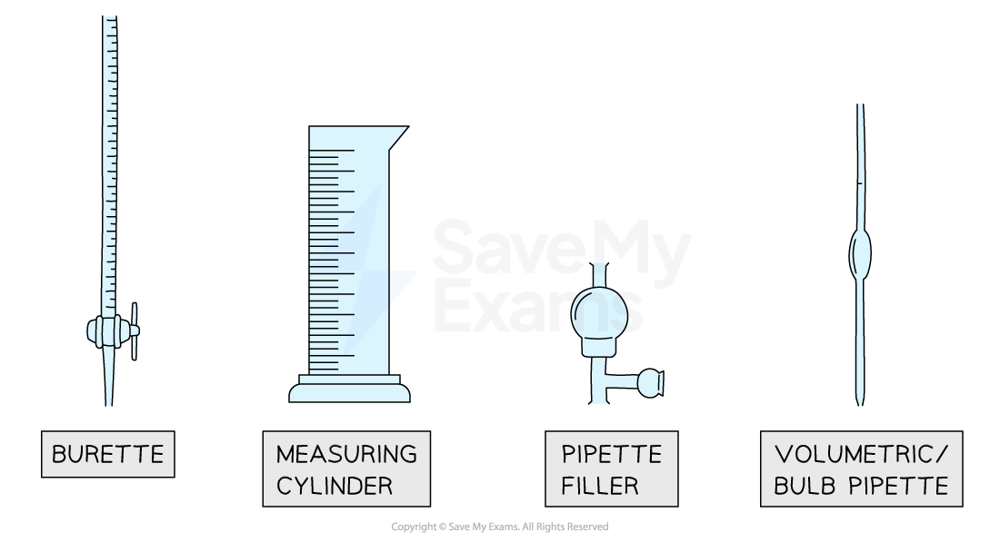
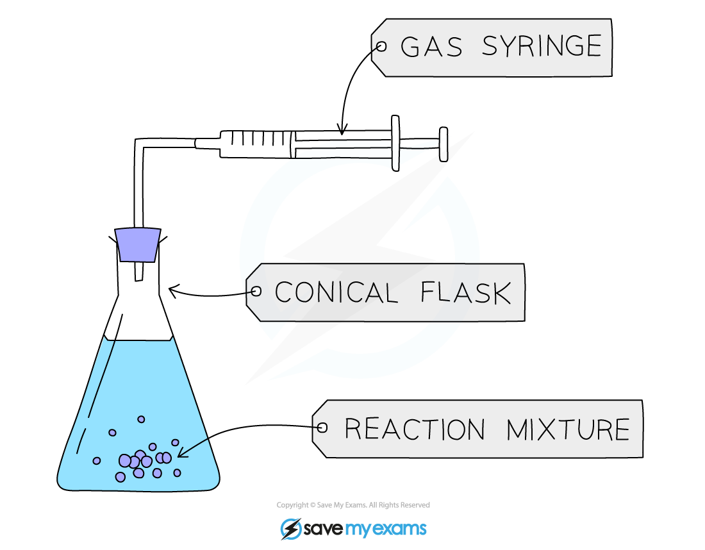
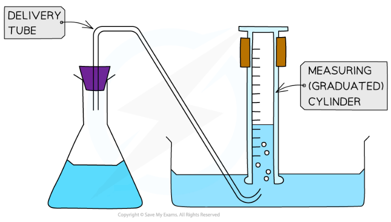

# Apparatus for Measurements

## Time, temperature, mass & volume

> **Spec point** — `spcpt_BrGBnpw9qgKXQ2fy`

## Time, temperature, mass & volume

### Time

- Time can be measured using a **stopwatch **or stopclock which are usually accurate to one or two decimal places
- The units of time normally used are **seconds **or **minutes**

  - Other units may be used for extremely slow reactions (e.g. rusting)
- **Remember: **1 minute = 60 seconds

> **Exam Hint**
> **Careful:** Units of time often cause issues in results tables.
> 
> If the display on a stopwatch showed 1:30.
> 
> - The incorrect time to record would be 1.30 minutes.
> - The correct time would be 1.5 minutes.
> 
> To avoid any confusion, if the time intervals are less than a minute, it is best / easire to change the recorded units to seconds.
> 
> - So, the same stopwatch display would be recorded as 90 seconds.

### Temperature

- Temperature is measured with a **thermometer **or digital **temperature probe**

|  |  |
|---|---|

- Laboratory thermometers usually have a precision of a half or one degree

  - Digital temperature probes are available which are more ***precise*** than traditional thermometers and can often read to 0.1 oC
- Traditional thermometers rely upon the uniform expansion and contraction of a liquid substance with temperature

  - Digital temperature probes can be just as, if not, more ***accurate*** than traditional thermometers
- The units of temperature are **degrees Celsius (ºC)**

### Mass

- Mass is measured using a **digital balance** which normally gives readings to two decimal places
- Balances should be:

  - Tared (set to zero) before use
  - Allowed time to settle on a final measurement / reading before it is recorded

- The standard unit of mass in kilograms (kg)

  - However, in chemistry **grams (g)** are most often used
- **Remember: **1 kilogram = 1000 grams

### Volumes of liquid

- The volume of a liquid can be determined using different pieces of apparatus

  - The choice of apparatus depends on the level of accuracy needed
- Three common pieces of apparatus for measuring the volume of a liquid are:

  - **Burettes**
  - **Volumetric pipettes**
  - **Measuring cylinders**

- **Burettes **are the most accurate way of measuring a **variable** volume of liquid between 0 cm3 and 50 cm3

  - They are most commonly used in [titrations](https://www.savemyexams.com/igcse/science/cie/co-ordinated-sciences-double-award/23/chemistry/revision-notes/experimental-techniques-and-chemical-analysis/experimental-techniques/acid-base-titrations/)
  - **Careful: **Read the burette scale from top to bottom as 0.00 cm3 is at the top of the column
- **Volumetric pipettes** are the most accurate way of measuring a **fixed** volume of liquid,

  - They have a scratch mark on the neck which is matched to the bottom of the meniscus to make the measurement
  - A pipette filler is used to draw the liquid into the volumetric pipette
  - The most common volumes for volumetric pipettes are 10 cm3 and 25 cm3
- **Measuring cylinders **are used when approximate volumes are required (accuracy is not an important factor)

  - These are graduated (have a scale so can be used to measure)
  - Measuring cylinders typically range from 10 cm3 to 1 litre (1 dm3)
- Whichever apparatus you use, you may see markings in millilitres, ml, which are the same as a cm3

### Volumes of gas

- For some experiments, the volume of a gas produced needs to be measured
- This is typically done by using one of the following methods:

  - Using a **gas** **syringe**
  - By **downward displacement of water**
- A **gas syringe **is more precise and accurate than downward displacement of water

***Diagram of the set-up for an experiment involving a gas syringe***

- **Downward displacement of water** is where a **measuring cylinder **is inverted in water to collect the gas produced

  - This method does not work if the gas is soluble in water

***Diagram of the set-up for an experiment collecting gas by downward displacement of water***

- If the gas happens to be heavier than air and is coloured, the cylinder does not need to be inverted
