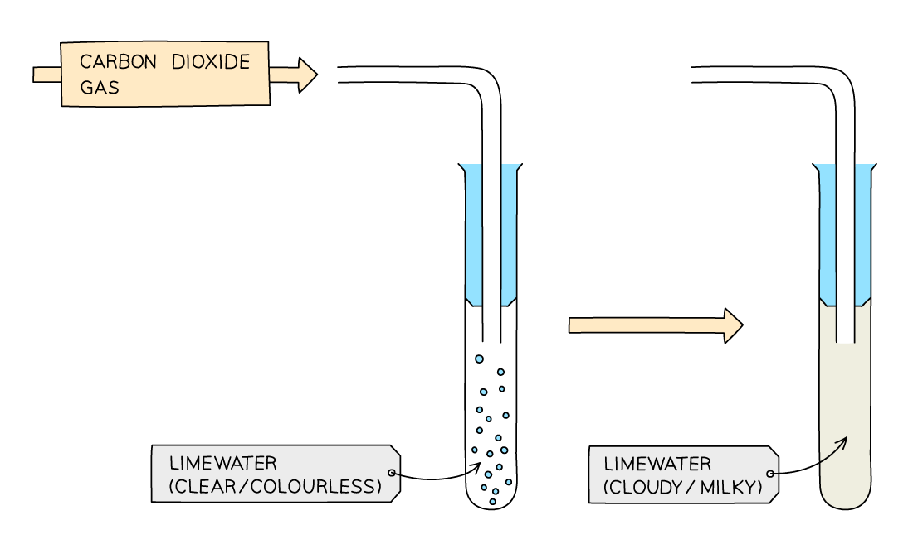
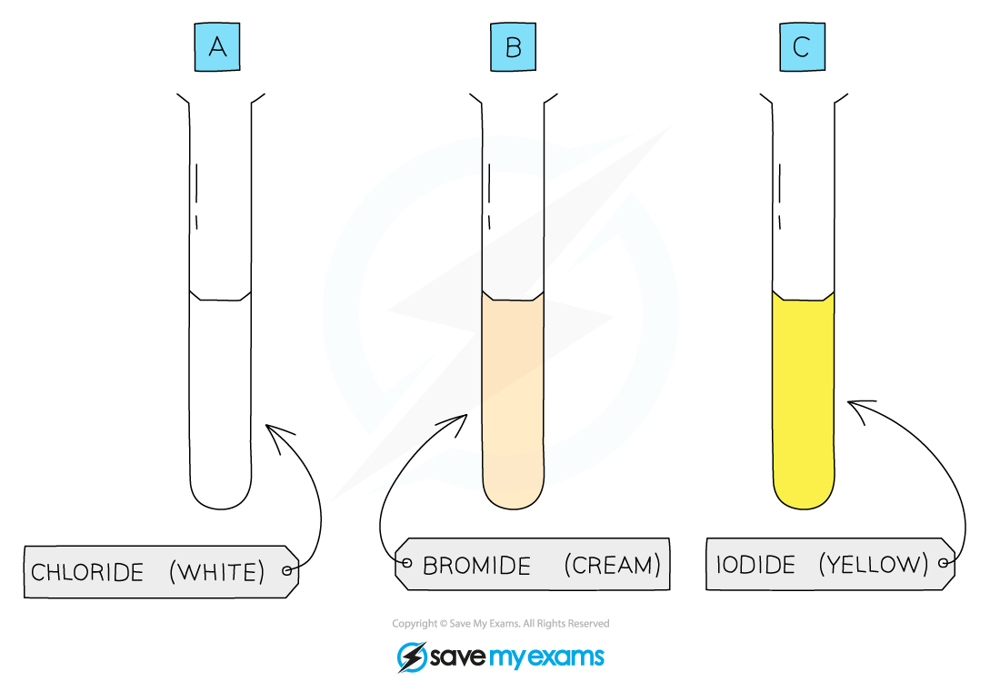

# Identification of Anions

## Identification of anions

> **Spec point** — `spcpt_nGjjGSjNytfhhjXK`

## Identification of anions

- Negatively charged non-metal ions are known as **anions**
- You must be able to **describe **the tests for the following ions:

  - Carbonate ions, CO32–
  - Halide ions, Cl– , Br– , I–
  - Sulfate ions, SO42–

### Test for carbonate ions (CO32-)

- Carbonate compounds contain the carbonate ion, CO32-

#### Test

- Add **dilute acid** to the sample
- A gas is produced
- Bubble the gas through **limewater**

#### Result

- **Limewater turns cloudy** if carbon dioxide is present
- This happens because carbon dioxide reacts with limewater to form a white precipitate of calcium carbonate
-

#### Key observation

- **Fizzing / effervescence** when acid is added
- Limewater turns **cloudy**

*Limewater turns milky in the presence of carbon dixoide caused by the formation of insoluble calcium carbonate*

> **Exam Hint**
> - If you are asked to describe the test for carbonate ions, make sure that you say:
> 
>   - Bubble the gas produced through limewater, which turns cloudy if the carbonate ion is present
> - Just saying that limewater turns cloudy is not enough
> 
>   - This isn't describing the test, it is stating the result

## Test for halide ions (Cl-, Br-, I-)

- Halide ions are negative ions (anions) formed by Group 7 elements.

### Test

- **Acidify** the sample with **dilute nitric acid**
- Add **aqueous silver nitrate**

### Result

- A **silver halide precipitate** forms.
The colour of the precipitate identifies the halide ion:

  - **Chloride (Cl⁻):** white precipitate (silver chloride)
  - **Bromide (Br⁻):** cream precipitate (silver bromide)
  - **Iodide (I⁻):** yellow precipitate (silver iodide)
- The colour of the silver halide precipitate depends on the halide ion:

  - The chloride ion forms a **white **precipitate of silver chloride

**potassium chloride +  silver nitrate   →  potassium nitrate + silver chloride **

**KCl (aq)   +     AgNO****3**** (aq)   →  KNO****3**** (aq)  +  AgCl (s) **

- The bromide ion forms a **cream** precipitate of silver bromide

**potassium bromide +  silver nitrate   →  potassium nitrate + silver bromide**

**KBr (aq)   +     AgNO****3**** (aq)   →  KNO****3**** (aq)  +  AgBr (s) **

- The iodide ions forms a **yellow **precipitate of silver iodide

**potassium iodide +  silver nitrate   →  potassium nitrate + silver iodide**

**KI (aq)   +     AgNO****3**** (aq)   →  KNO****3**** (aq)  +  AgI (s) **

*Each silver halide produces a precipitate of a different colour*

> **Exam Hint**
> The acidification step in the halide ion test must be done with nitric acid rather than hydrochloric acid.
> 
> HCl contains the chloride ion which would interfere with the results.

### Test for sulfate ions (SO42-)

- Sulfate compounds contain the sulfate ion, SO₄²⁻.

### Test

- **Acidify** the sample with **dilute nitric acid**
- Add **aqueous barium nitrate**

### Result

- A **white precipitate** of barium sulfate forms if sulfate ions are present

**Ba****2+**** (aq) + SO****4****2-**** (aq) → BaSO****4**** (s)**

- The test can also be carried out with barium nitrate solution

*A white precipitate of barium sulfate is a positive result for the presence of sulfate ions*

> **Exam Hint**
> Nitric is added first to remove any **carbonates **which may be present which would also produce a precipitate and interfere with the results.

> **Exam Hint**
> For qualitative inorganic analysis, there will be one test for the metal **cation** and another test for the non-metal **anion**.
> 
> If you are an extended level student you may be asked to write balanced ionic equations for cation and anions tests, so make sure you know the formulae of all the ions and precipitates formed.
