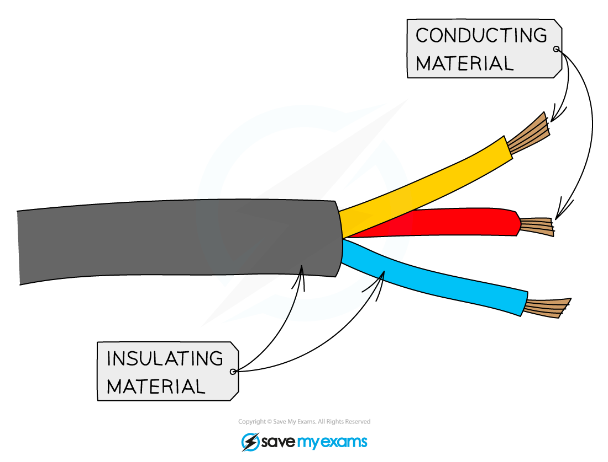

# Uses of Metals

## Uses of metals

> **Spec point** — `spcpt_3Y8s9zqqcd5rBdfQ` · Describe the uses of metals in terms of their physical properties, including: 
aluminium in the manufacture of aircraft because of its low density 
aluminium in the manufacture of overhead electrical cables because of its low density and good electrical conductivity 
aluminium in food containers  because of its resistance to corrosion 
copper in electrical wiring because of its good electrical conductivity and ductility

## Uses of metals

### What is aluminium used for?

- Aluminium is a reactive metal
- Aluminium is widely used because it has a **low density** and is **resistant to corrosion**
- It forms a thin protective layer of aluminium oxide on its surface, which prevents further corrosion

**Uses of aluminium**

| **Use** | **Property** |
|---|---|
| **aeroplane bodies** | high strength-to-weight ratio, low density |
| **overhead power cables** | good electrical conductor, low density |
| **food cans** | non-toxic, resistant to corrosion and acidic foods |

### What is copper used for?

- Copper is an unreactive metal
- Copper is widely used because it is a **very good electrical conductor** and is **ductile**
- This means it can carry electrical current efficiently and be drawn into thin wires

***Copper is usually the metal inside electrical wires due to it's high conductivity***

**Uses of copper**

| **Use** | **Property** |
|---|---|
| **electrical wiring** | very good conductor of electricity and ductile |
| **pots and pans** | very good conductor of heat, unreactive, malleable |
| **water pipes** | non-toxic, unreactive (does not react with water) and malleable |
