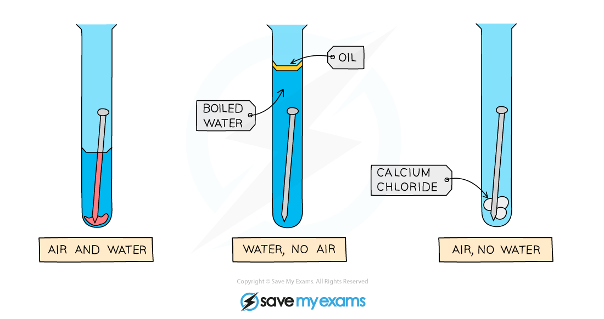

# Rusting of Iron

## Rusting of iron

> **Spec point** — `spcpt_DCVGP2B8XHRfvn7g` · State the conditions required for the rusting of iron and steel to form hydrated iron(III) oxide 
State some common barrier methods, including painting, greasing and coating with plastic 
Describe how barrier methods prevent rusting by excluding oxygen or water

## Rusting of iron

### What is rusting?

- Rusting is a chemical reaction between iron, water and oxygen

  - Rust is the reddish-brown compound product called hydrated iron(III) oxide
- Both oxygen and water must be present for rusting to occur
- During rusting, iron is oxidised

**iron +  water + oxygen  →  hydrated iron(III) oxide **

### Investigating rusting

- To investigate the conditions required for rusting, prepare three test tubes as shown in the diagram:

*Diagram showing the requirements of oxygen and water for rust to occur: only the nail exposed to both air and water rusts*

- Test-tube 1 contains water and air (oxygen)

  - After a few days, the iron nail in this test-tube will show signs of rust
- Test-tube 2 contains water but no air (oxygen)

  - After a few days, this test-tube will not show signs of rust because:
  
    - The oil layer keeps out air
    - The water has been boiled so that no air is left in it
- Test-tube 3 contains air (oxygen) but no water

  - After a few days, this test-tube will not show signs of rust because:
  
    - The calcium chloride removes any moisture in the air

### Rust prevention methods

- Rust can be prevented using barrier methods

  - A barrier is some form of coating that prevents iron from coming into contact with water and oxygen
- Common barrier methods include:

  - Grease / oil
  - Paint
  - Plastic coating
- However, if the barriers are removed or scratched, the iron is exposed to water and oxygen and will rust

> **Exam Hint**
> When a metal breaks down due to oxidation, you should say that the metal has **corroded**
> 
> **Rusting **is specific to iron and metals containing iron, such as steel
