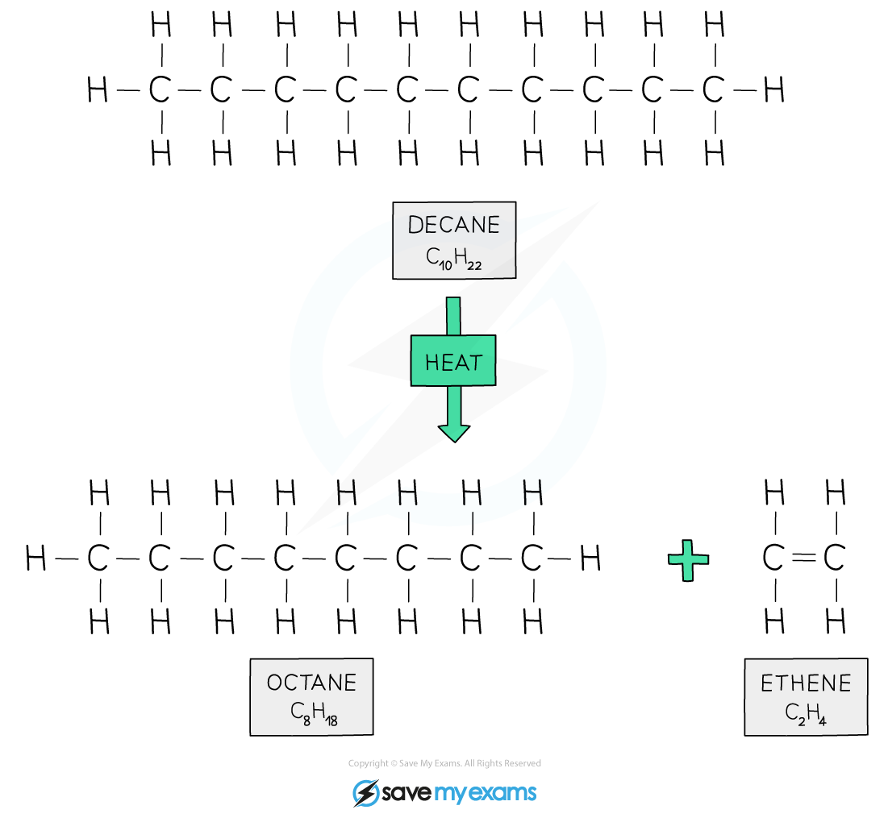
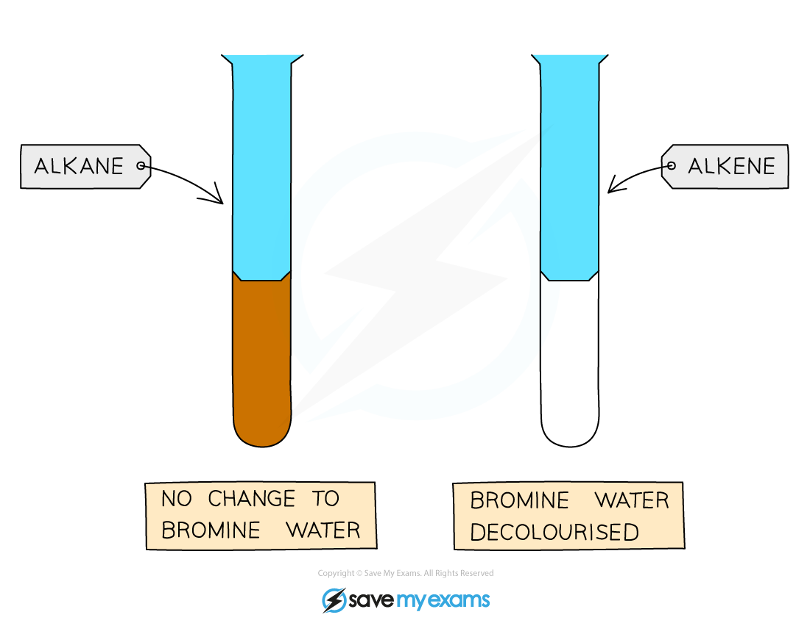

# Alkenes

## Catalytic cracking

> **Spec point** — `spcpt_57VkQzhsgvqF5Hkf` · nan

## Catalytic cracking

- Alkenes are **unsaturated** hydrocarbons

  - This means that they contain at least one carbon-carbon double bond (C=C)
- The bonding in alkenes is **covalent**, as they consist only of non-metal atoms
- Their general formula is** C****n****H****2n**

#### Table of alkenes

| **Displayed formula** | **Name** | **Molecular formula** |
|---|---|---|
|  | ethene | C2H4 |
|  | propene | C3H6 |
|  | but-1-ene | C4H8 |
|  | pent-1-ene | C5H10 |

***The first four members of the alkene homologous series***

### Why alkenes are more reactive than alkanes

- The carbon–carbon double bond can **open up** and form new bonds.
- This allows alkenes to react more easily than alkanes, which only contain strong single covalent bonds.

## Manufacture of alkenes and hydrogen (cracking)

**Extended tier only**

- Although fractional distillation produces useful fractions, it produces:

  - **Too many *****long chain hydrocarbons***** **
  - **Not enough *****short-chain***** hydrocarbons**, such as petrol and alkenes
- To solve this, long-chain alkane molecules are broken down into smaller, more useful molecules in a process called **cracking**

### What is cracking?

- Cracking is the **thermal decomposition** of long-chain alkanes into:

  - Shorter-chain **alkanes**
  - One or more** alkenes**
  - **Hydrogen**
- Kerosene and diesel oil are often cracked to produce petrol, other alkenes and hydrogen

### Conditions for cracking

- Cracking requires:

  - A **high temperature** (around **600–700 °C**)
  - A **catalyst**, usually **aluminium oxide (alumina)** or **silicon dioxide (silica)**

### What happens during cracking

- Long-chain alkane vapours are heated
- The vapours pass over the hot catalyst
- **Carbon–carbon bonds break**
- A mixture of smaller alkanes, **alkenes**, and **hydrogen** is formed

### Example of cracking

- A long-chain alkane can be cracked to form an alkene and a shorter alkane:

decane → octane + ethene

C10H22 → C8H18 + C2H4

*Decane is cracked to produce octane (petrol) and ethene for ethanol*

### Why cracking is important

- Alkenes are used to make **polymers**
- Hydrogen is used in processes such as **ammonia manufacture**
- It increases the supply of **useful fuels** like petrol

## Distinguishing from alkanes

> **Spec point** — `spcpt_znn26bCY2Fpv8CZQ` · nan

## Distinguishing from alkanes

- The presence of a **C=C double bond** allows alkenes to be identified using **aqueous bromine **
- Aqueous bromine, Br2 (aq), is an **orange solution** of bromine dissolved in water

  - It is often called **bromine water**

### Testing with aqueous bromine

- A few drops of aqueous bromine are added to the sample
- The sample is then shaken

#### Results

- **Alkane + aqueous bromine **

  - No colour change
  - The solution remains orange
- **Alkene + aqueous bromine **

  - Aqueous bromine is **decolourised**
  - Colour change: orange → colourless

*Alkenes decolourise aqueous bromine *

- This happens because bromine reacts with the C=C double bond and is no longer present in solution.

> **Exam Hint**
> Always say **colourless**, not clear, when describing the result with an alkene
