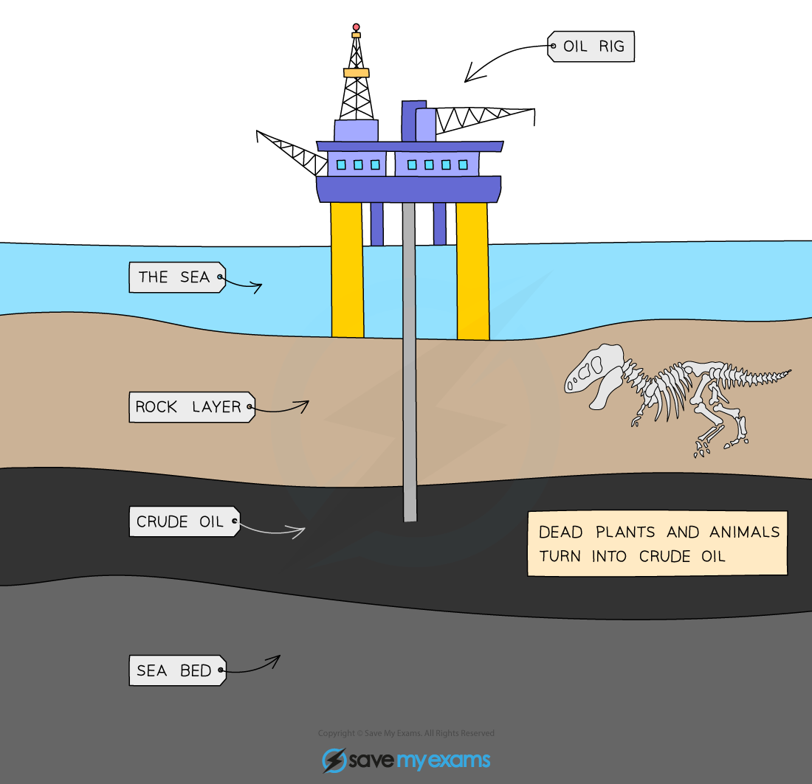

# Fossil Fuels

## Common fossil fuels

> **Spec point** — `spcpt_sjvK4dGdQTFQYgP3`

## Common fossil fuels

- A fuel is a substance which when burned, releases heat energy
- This can be transferred into electricity, which we use in our daily lives
- The main fossil fuels are:

  - **Coal**
  - **Natural gas**
  - **Petroleum**
- **Methane, **CH4, is the main constituent of natural gas and is a hydrocarbon

  - **Hydrocarbons **are made from hydrogen and carbon atoms only

## Fractional Distillation

> **Spec point** — `spcpt_cT9dYW2GvFrMCxwF`

## Petroleum & fractional distillation

### Petroleum

- Petroleum is also called **crude oil **
- It is a mixture of hydrocarbons
- It is a thick, sticky, black liquid that is found under porous rock (under the ground and under the sea)

#### The location of crude oil

*Crude oil is located under the sea*

- Petroleum itself as a mixture is not very useful

  - However, the mixture can be separated into useful parts called ***fractions***
  - Each fraction has different uses

### Fractional distillation

- Each fraction consists of groups of hydrocarbons with **similar** chain lengths
- The fractions in petroleum are separated from each other in a process called **fractional distillation**
- Fractional distillation separates fractions according to their boiling points
- Fractional distillation is carried out in a fractionating column which has a temperature gradient

  - It is very hot at the bottom of the column and cooler at the top
- During fractional distillation:

  - The crude oil is heated and vapourises
  - The vapours enter the fractionating column
  - Hydrocarbons with high boiling points condense near the bottom of the column
  - Hydrocarbons with lower boiling points rise up the column and condense higher up

#### Diagram to show fractional distillation

*The process separates the fractions according to their boiling point*

### Uses of Fractions

- Refinery gas: heating and cooking
- Gasoline: fuel for cars (petrol)
- Naphtha: raw product for producing chemicals
- Diesel: fuel for diesel engines (gas oil)
- Bitumen: for surfacing roads

## Properties of fractions

> **Spec point** — `spcpt_jvYn2WJBktQnPkhr`

## Properties of fractions

**Extended tier only**

- From the bottom to the top of the fractionating column:

  - Chain length decreases
  - Boiling points decrease

- **Melting point/boiling point**

  - As the molecules get larger, the forces between molecules get stronger
  - So, more heat is needed to separate the molecules
  - Going down the column, the boiling points of the fractions increase

#### Table to show the trends in properties

| **Fraction** | **Chain length (relative)** | **Boiling point (relative)** |
|---|---|---|
| Refinery gas | Shortest | Lowest |
| Gasoline / petrol | Short | Low |
| Naptha | Medium | Medium |
| Diesel / gas oil | Long | High |
| Bitumen | Longest | Highest |

> **Exam Hint**
> You **must **be able to recall a use for each fraction as well describe the trends in properties.
