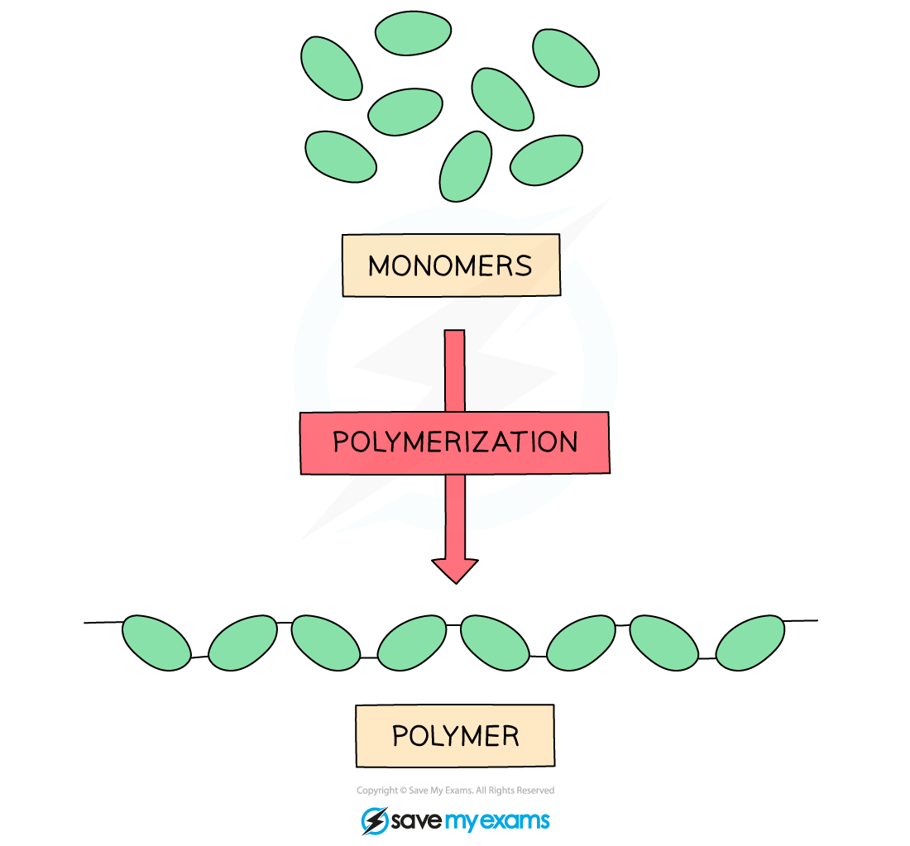
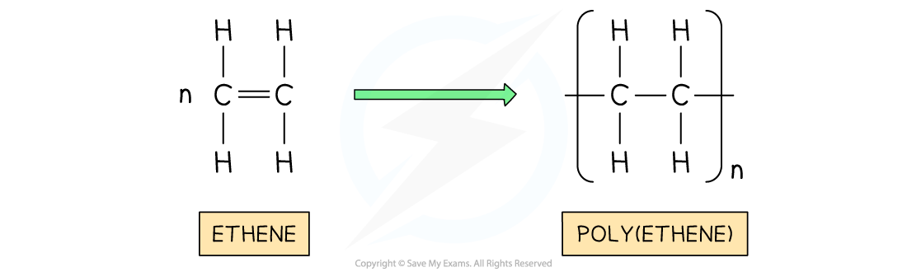

# Polymers

## Polymers: the basics

> **Spec point** — `spcpt_mYgXZ43zVVZsSVhT` · nan

## Polymers: the basics

- Polymers are large molecules built up from many smaller molecules called **monomers**

*Monomers join together to form long chains (polymers)*

- Each monomer is joined to the next by **covalent bonds**
- Examples of polymers include:

  - Poly(ethene) - addition polymer
  - PVC - addition polymer
  - Nylon - condensation polymer

### Addition polymerisation

- Poly(ethene) is formed by the **addition polymerisation** of ethene monomers
- Ethene is an **alkene**, so it contains a carbon–carbon double bond (C=C)
- During addition polymerisation:

  - The C=C double bond in each monomer breaks
  - The monomers join together to form a long-chain polymer
  - **Only one product is formed**
- Many ethene monomers join together to form **poly(ethene)**

*Poly(ethene) is formed by addition polymerisation using ethene monomers*
