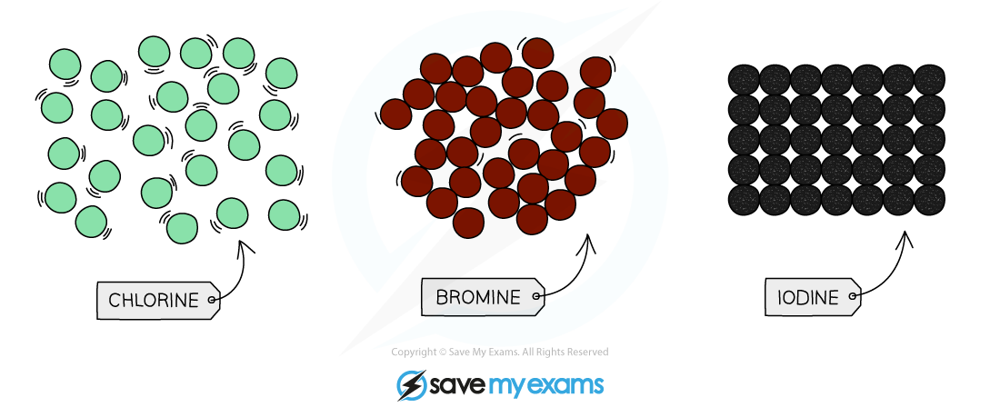
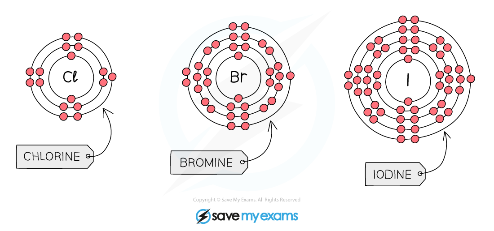

# Group VII Properties

## Group VII properties & trends

> **Spec point** — `spcpt_6GPBZTzJRkKxVGnG` · Describe the Group VII halogens, chlorine, bromine and iodine, as diatomic non-metals with general trends down the group, limited to: 
increasing density 
decreasing reactivity
State the appearance of the halogens at r.t.p. as: 
chlorine, a pale yellow-green gas 
bromine, a red-brown liquid 
iodine, a grey-black solid

## Group VII properties & trends

- These are the Group VII non-metals that are** poisonous** and include fluorine, chlorine, bromine, iodine and astatine
- Halogens are **diatomic**

  - This means that they form molecules containing **two** atoms
- The formulae of the halogens are:

  - Fluorine = F2
  - Chlorine = Cl2
  - Bromine = Br2
  - Iodine = I2 
  - Astatine =  At2
- All halogens have seven electrons in their outer shell

  - They form ***halide*** ions by gaining one more electron to complete their outer shells
- Fluorine is not allowed in schools so observations and experiments tend to only involve chlorine, bromine and iodine

### Properties of the halogens

#### Physical state, colour and density

- At room temperature (20 °C), the physical state of the halogens changes as you go down the group

  - Chlorine is a **pale yellow-green gas**
  - Bromine is a **red-brown liquid**
  - Iodine is a **grey-black** **solid**
- This demonstrates that the **density** of the halogens **increases** as you go **down the group:**

*The physical state of the halogens at room temperature*

> **Exam Hint**
> Solid iodine, iodine in solution and iodine vapour are different colours.
> 
> - Solid iodine is dark **grey-black**
> - Iodine vapour is **purple**
> - Aqueous iodine is **brown**.

#### Reactivity

- The **reactivity** of Group 7 elements **decreases **as you go down the group

  - This is the opposite trend to Group 1
- When a halogen reacts, it needs to gain one outer electron to achieve a full outer shell of electrons
- As you go down Group 7, the number of electron shells **increases**

*Diagram showing the electronic configuration of the first three elements in Group 7*

- The increasing number of electron shells has two main effects:

  - The **atomic radius increases**, so the outer shell is further from the nucleus
  - There is more **electron shielding **from the inner shells** **
- These factors reduce the force of attraction between the nucleus and an incoming electron
- Therefore, it becomes harder to attract an electron
- This means that the reactivity of the halogens **decreases** down the group

## Predicting group VII properties

> **Spec point** — `spcpt_YjRgSgkbJ7kKwYhS` · Predict the properties of other elements in Group VII, given information about the elements

## Predicting group VII properties

**Extended only**

- You may be given information about some elements and asked to predict the properties of other elements in the group
- The information you might be given could be in relation to melting/boiling point or physical state/density so it is useful to know the trends in properties going down the group

### Predicting melting and boiling point

- The melting and boiling point of the halogens **increases **as you go down the group
- Fluorine is at the top of Group 7

  - It has the **lowest** melting and boiling point
- Astatine is at the bottom of Group 7

  - It has the **highest** melting and boiling point

### Predicting physical states and density

- The halogens become **denser** as you go down the group
- Fluorine is at the top of Group 7

  - It is a **gas**
- Astatine is at the bottom of Group 7

  - It is a **solid**

### Predicting colour

- The colour of the halogens becomes **darker** as you go down the group
- Fluorine is at the top of Group 7 so the colour will be **lighter**

  - Fluorine is **yellow**
- Astatine is at the bottom of Group 7 so the colour will be **darker**

  - Astatine is **black**

> **Exam Hint**
> You can be asked to identify trends in chemical or physical properties of the Group 7 elements, given appropriate data.
> 
> 1. Place the elements and associated data in either ascending or descending order according to their position in Group 7
> 2. Look for any general patterns in the data
